# Wallet Ledger · Architecture

How the wallet is built: every money movement is a double-entry journal transaction in Postgres, and balances are derived from those entries. Part 1 is the overview, Part 2 goes file by file through how the app works inside, and the end has manual test cases with `curl`.

> Interactive version (with checkboxes to track tested cases): open [`architecture.html`](architecture.html) in a browser.

**Part 1 · Overview**

- [Architecture](#architecture)
- [Accounts and journal entries](#accounts-and-journal-entries)
- [Worked example](#worked-example)
- [Deposit and hold states](#deposit-and-hold-states)
- [Idempotency](#idempotency)
- [Concurrency: why it never goes negative](#concurrency-why-it-never-goes-negative)
- [Data model](#data-model)
- [Invariants and where they are enforced](#invariants-and-where-they-are-enforced)

**Part 2 · Deep dive**

- [How it maps to the real world](#how-it-maps-to-the-real-world)
- [Project map](#project-map)
- [Nest module graph](#nest-module-graph)
- [Request lifecycle inside Nest](#request-lifecycle-inside-nest)
- [Boot and shutdown](#boot-and-shutdown)
- [TransactionHost and AsyncLocalStorage](#transactionhost-and-asynclocalstorage)
- [postTransaction step by step](#posttransaction-step-by-step)
- [Balance sign math](#balance-sign-math)
- [Full trace: settling a deposit](#full-trace-settling-a-deposit)
- [Full trace: a hold without funds](#full-trace-a-hold-without-funds)
- [Why sorted locking prevents deadlocks](#why-sorted-locking-prevents-deadlocks)
- [Error handling](#error-handling)
- [Reconciliation](#reconciliation)
- [Entry history pagination](#entry-history-pagination)
- [Test architecture](#test-architecture)

**[Manual test cases](#manual-test-cases)**

---

# Part 1 · Overview

## Architecture

A `POST` request first goes through the idempotency interceptor, which opens the Postgres transaction. Everything the controller and services do happens inside that transaction. Services never open connections: they ask `TransactionHost` for the current client, which it keeps in an `AsyncLocalStorage`. `GET` handlers open their own transaction with `tx.run()`.

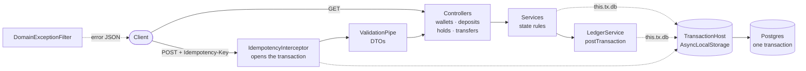

*Solid line: a call. Dotted line: everything shares the request's single Postgres client.*

## Accounts and journal entries

Each wallet has three accounts of its own, plus three shared system accounts. A journal transaction moves money between accounts: it always has at least two lines and sums to exactly 0. In the database a positive amount is a **debit** and a negative one is a **credit**.

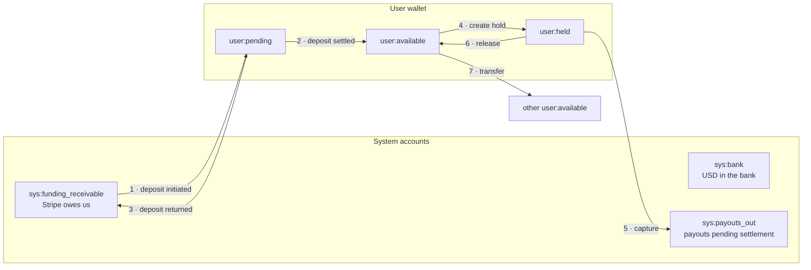

*Each arrow is a journal transaction: money leaves the source account (debit) and enters the destination (credit). Settlement also moves money from `funding_receivable` to `bank`.*

| # | Operation | Debit (+) | Credit (−) | Journal key |
|---|---|---|---|---|
| 1 | Deposit initiated | `sys:funding_receivable` | `user:pending` | `deposit:<id>:initiated` |
| 2 | Deposit settled | `user:pending` + `sys:bank` | `user:available` + `sys:funding_receivable` | `deposit:<id>:settled` |
| 3 | Deposit returned | `user:pending` | `sys:funding_receivable` | `deposit:<id>:returned` |
| 4 | Create hold | `user:available` | `user:held` | `hold:<id>:created` |
| 5 | Capture hold | `user:held` | `sys:payouts_out` | `hold:<id>:captured` |
| 6 | Release hold | `user:held` | `user:available` | `hold:<id>:released` |
| 7 | Transfer | `userA:available` | `userB:available` | `transfer:<from>:<Idempotency-Key>` |

> **Why does a credit increase the user's balance?** User accounts are **credit-normal**: they represent money the platform owes the user, so they grow with credits. `sys:funding_receivable` and `sys:bank` are debit-normal and grow with debits. `LedgerService` turns each line into a balance change according to the account's `normal_side` (see *Balance sign math* in Part 2).

## Worked example

Juan deposits $100 by ACH, it settles, he holds $25 for a payout and the payout goes out. Amounts in cents. Bold cells are the accounts that change in each step.

| Step | pending | available | held | funding_rec. | bank | payouts_out |
|---|--:|--:|--:|--:|--:|--:|
| Wallet created | 0 | 0 | 0 | 0 | 0 | 0 |
| 1 · Deposit initiated (10,000) | **10,000** | 0 | 0 | **10,000** | 0 | 0 |
| 2 · Deposit settled | **0** | **10,000** | 0 | **0** | **10,000** | 0 |
| 4 · Hold of 2,500 | 0 | **7,500** | **2,500** | 0 | 10,000 | 0 |
| 5 · Hold captured | 0 | 7,500 | **0** | 0 | 10,000 | **2,500** |

At the end the bank holds 10,000: the platform owes Juan 7,500 and 2,500 is committed to the payout. What came in equals what is owed, which is why reconciliation sums to 0.

## Deposit and hold states

Every transition locks the row with `SELECT … FOR UPDATE`. Repeating the transition the row is already in (for example, a duplicate webhook) returns the object without doing anything. Any other transition is a 409.

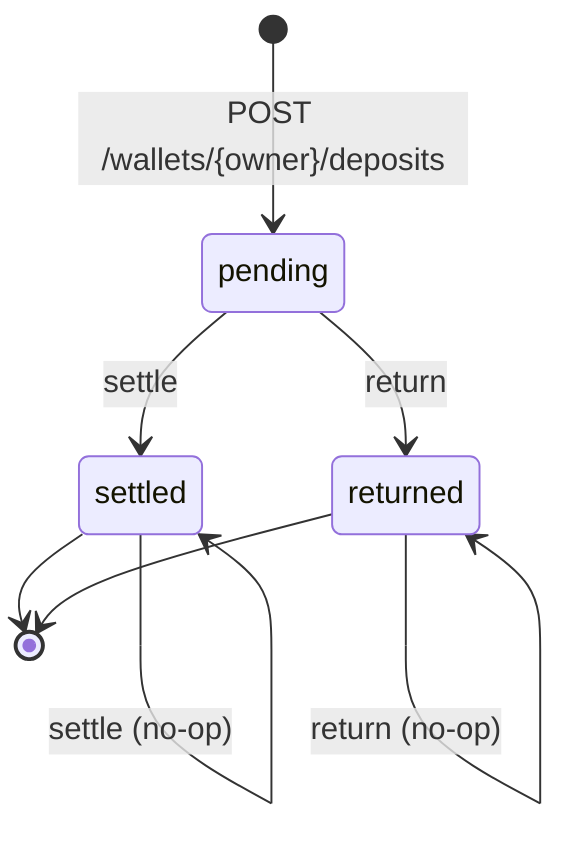

*Deposit. Settling a returned one, or returning a settled one: `409 deposit_not_pending`.*

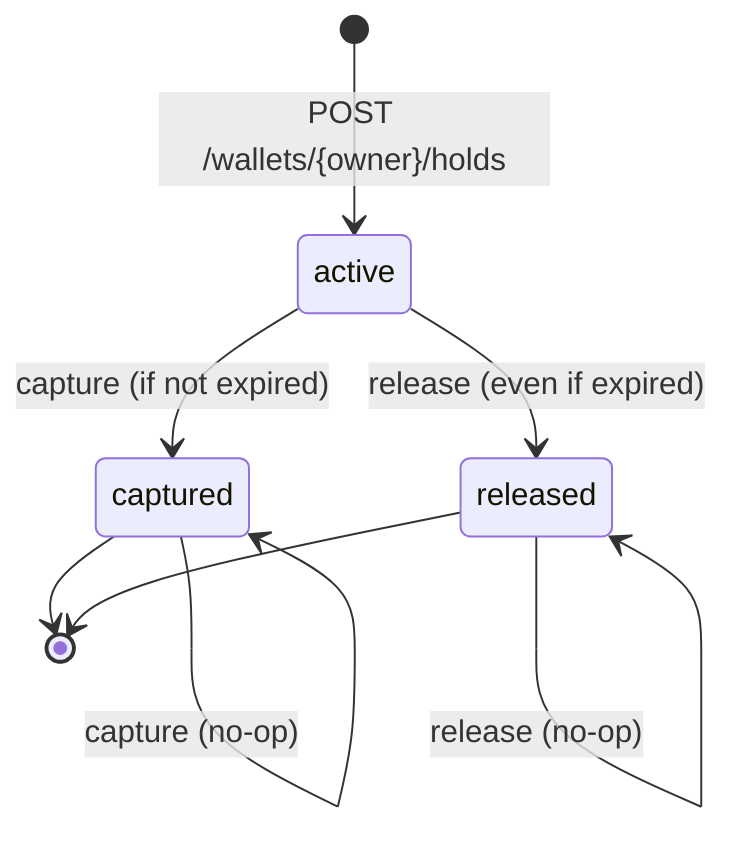

*Hold. 15-minute TTL by default. Capturing an expired one: `409 hold_expired`. Crossing states: `409 hold_not_active`.*

## Idempotency

The key, the response and the money movements are written in **one transaction**: either all of it commits, or none of it. If two requests arrive at once with the same key, the second one waits on the `INSERT` until the first commits, then returns the stored response.

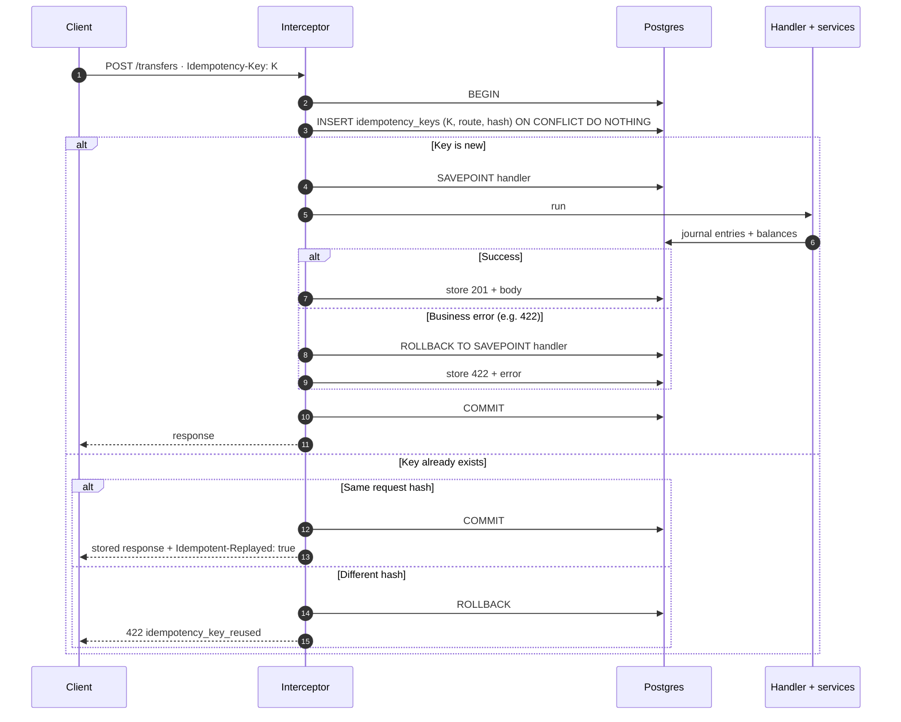

*An unexpected error (500) or a validation error (400) rolls back everything: the key is not stored and the client can retry with a fixed body. On top of that, every journal transaction has its own unique key, a second safety net in case the same entry is attempted twice.*

## Concurrency: why it never goes negative

Before computing the new balance, `postTransaction` locks the `balances` rows with `FOR UPDATE`, always sorted by `account_id` so two transactions never lock in crossed order (deadlock). Two holds on the same wallet run one after the other.

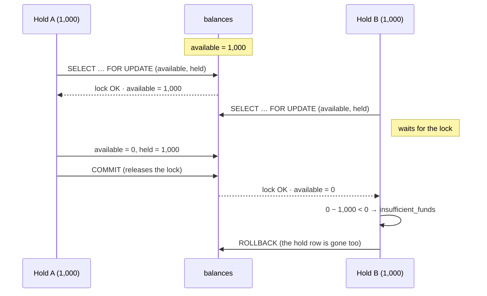

*The concurrency test fires 50 holds of 1,000 in parallel against 10,000: exactly 10 get through.*

## Data model

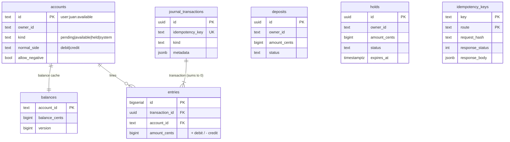

*`entries` and `journal_transactions` have triggers that reject UPDATE and DELETE. `deposits` and `holds` track process state; the money itself lives only in the ledger.*

## Invariants and where they are enforced

| # | Invariant | Where |
|---|---|---|
| 1 | Amounts are integer cents, never floats | `bigint` in the database; a `pg` parser that rejects values outside `Number.isSafeInteger`; DTOs with `@IsInt` |
| 2 | Every transaction has ≥ 2 lines and sums to 0 | `assertBalanced` in `src/ledger/ledger.service.ts`, before writing |
| 3 | The ledger is append-only | `forbid_mutation` trigger in `migrations/001_init.sql` |
| 4 | Balances are written together with their entries | Same `postTransaction`, same transaction |
| 5 | No user account goes negative, even under concurrency | `FOR UPDATE` sorted by `account_id` + `allow_negative` check |
| 6 | Exactly once per idempotency key | `IdempotencyInterceptor`: key, response and entries in one transaction |
| 7 | A pending ACH is never spendable | Deposits credit `user:pending`; holds and transfers only debit `user:available` |

---

# Part 2 · Deep dive

## How it maps to the real world

The API is the wallet core of a remittance app. Stripe pulls USD from the user's bank by ACH, which takes days and can bounce; a payout partner delivers the money abroad. This sequence shows which endpoint each real-world event calls.

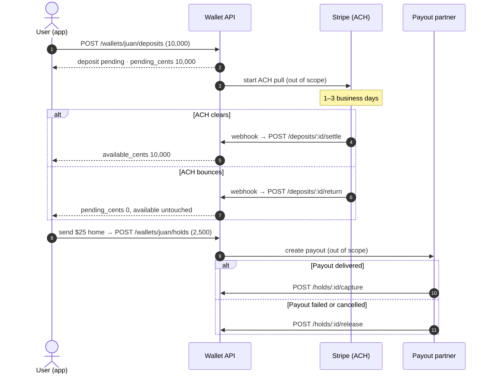

*Stripe and the payout partner are simulated: in this project you call those endpoints yourself (or the tests do).*

## Project map

Each folder in `src/` owns one concern. Arrows show who depends on whom: the wallet depends on the ledger, the ledger depends on the database, and nothing depends on the wallet.

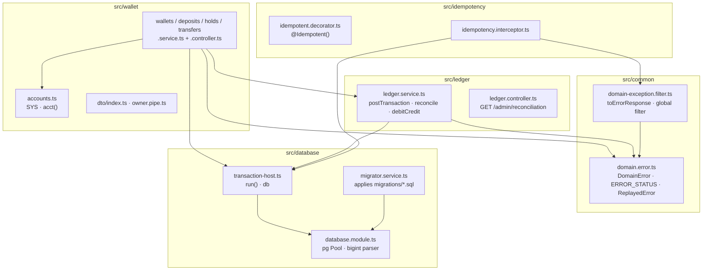

*`src/health` (GET /health) and `main.ts` / `app.module.ts` are left out to keep the picture readable.*

## Nest module graph

`AppModule` wires everything. `ConfigModule` and `DatabaseModule` are global, so any provider can inject `ConfigService`, `PG_POOL` or `TransactionHost` without importing them. The filter, the validation pipe and the interceptor are registered as `APP_*` providers, which makes them apply to every route, in tests too.

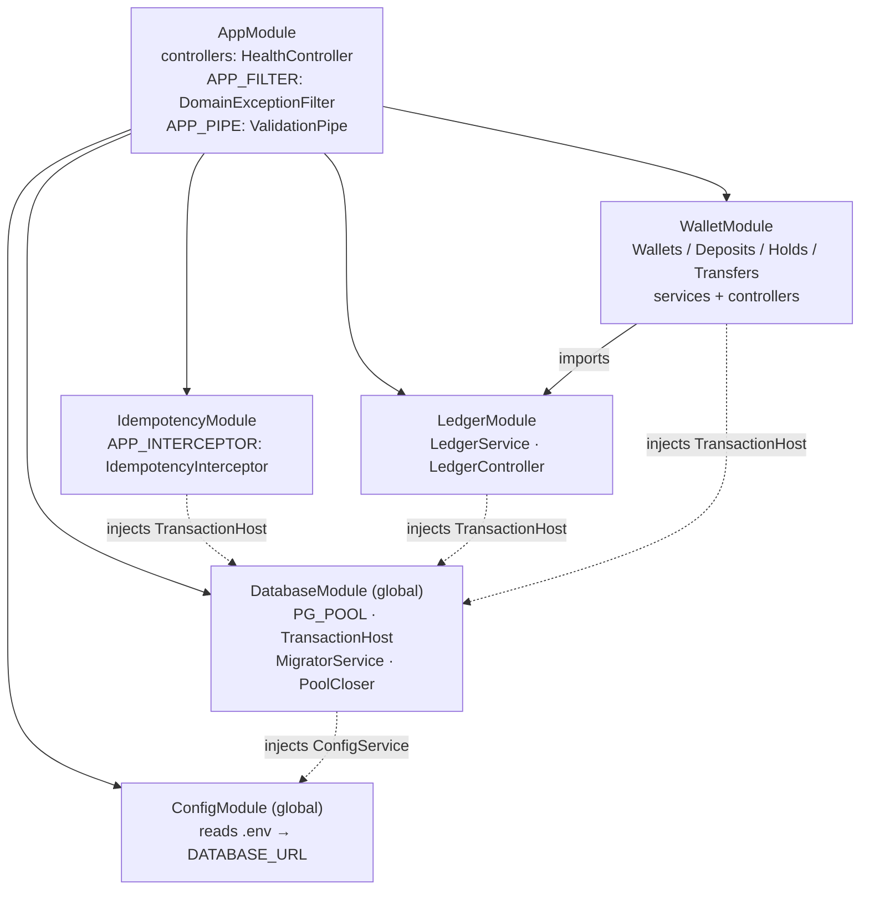

*Solid line: `imports`. Dotted line: injection through a global module.*

## Request lifecycle inside Nest

Nest runs a fixed pipeline for every request. The important detail: **pipes run inside `next.handle()`**, so the interceptor's transaction is already open when validation runs, and a validation error travels back through the interceptor's `catch`. That is why the interceptor decides what to store by error type.

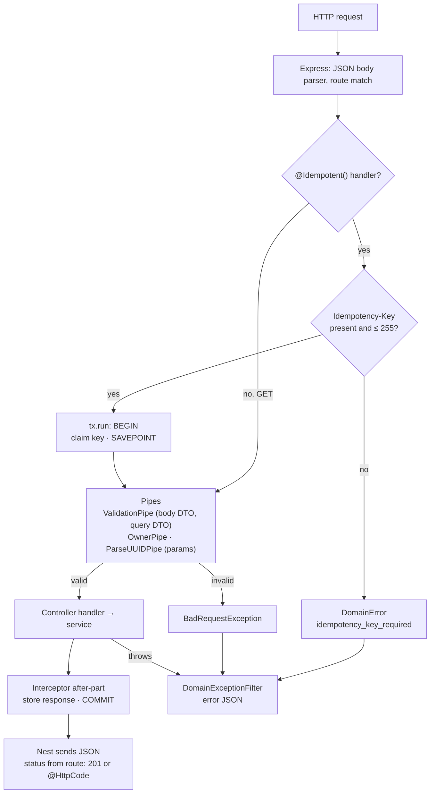

*Guards and middleware exist in Nest but this app doesn't use them (no auth yet).*

## Boot and shutdown

`pnpm start:dev` builds the module graph, creates the pool, runs migrations in `onModuleInit` and only then starts listening. A Postgres advisory lock makes sure two app instances (or two test files) never migrate at the same time.

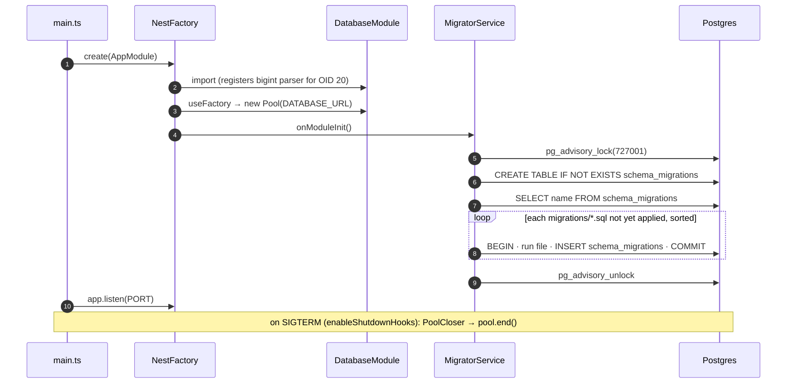

*Migrations are tracked by file name. To change the schema, add `002_….sql`; never edit an applied file.*

## TransactionHost and AsyncLocalStorage

`AsyncLocalStorage` gives each request its own invisible "context slot" that follows every `await`. `run()` puts the transaction's client in that slot; anything called inside reads it with `this.tx.db`. If `run()` is called while a transaction is already open, it reuses it instead of opening a second one.

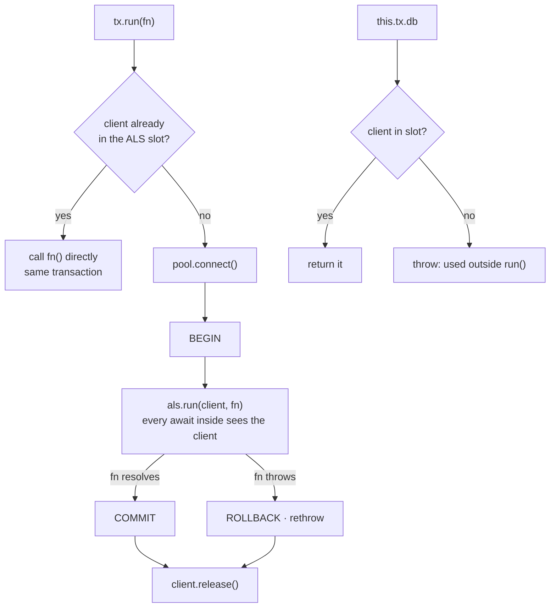

*Concurrent requests each get their own slot, so 50 parallel holds are 50 separate transactions.*

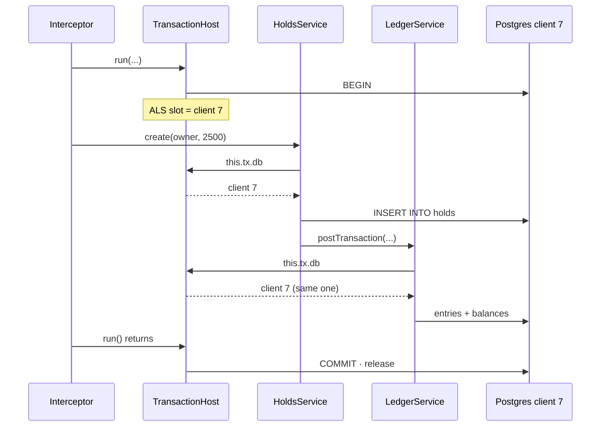

*Nobody passes the client around as an argument, yet every query lands in the same transaction.*

## postTransaction step by step

The single entry point for moving money. Every service builds a list of lines and hands it here.

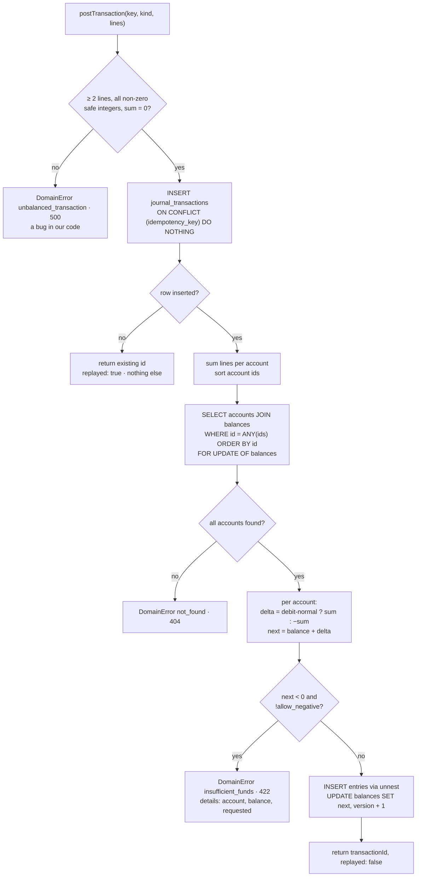

*Any error thrown here aborts the surrounding transaction (or savepoint), so the journal row inserted in step 2 disappears too. Nothing is ever half-written.*

## Balance sign math

Lines are stored with one sign convention (+ debit, − credit), but each account reports a "natural" balance that is positive when it holds value. The account's `normal_side` translates between the two.

| Account | normal_side | Line | delta | Effect |
|---|---|---|---|---|
| `sys:funding_receivable` | debit | +10,000 (debit) | +10,000 | Stripe owes us more |
| `user:pending` | credit | −10,000 (credit) | +10,000 | User sees money on the way |
| `user:available` | credit | +2,500 (debit) | −2,500 | User has less to spend |
| `user:held` | credit | −2,500 (credit) | +2,500 | Money reserved |
| `sys:payouts_out` | credit | −2,500 (credit) | +2,500 | Payout in flight |

> Rule: `delta = normal_side == 'debit' ? amount : −amount`. Reconciliation uses the same rule in SQL to recompute every balance from scratch.

## Full trace: settling a deposit

Everything that happens for one `POST /deposits/:id/settle`, from the HTTP request to the commit.

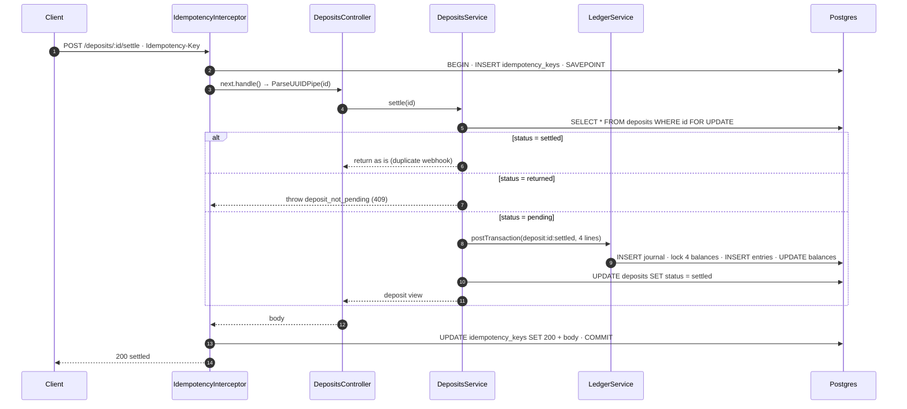

*The deposit row lock (step 5) is what makes two simultaneous webhooks safe: the second one waits, then sees `settled`.*

## Full trace: a hold without funds

Why a failed hold leaves nothing behind and why the retry gets the same 422 without running again.

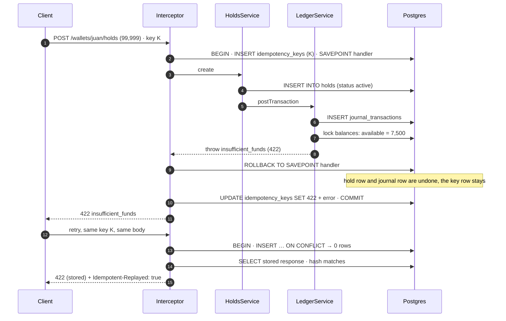

*The savepoint is the trick: it lets the interceptor undo the handler's writes while keeping its own key row.*

## Why sorted locking prevents deadlocks

Two transfers in opposite directions at the same time: Ana → Beto and Beto → Ana. Each needs both `available` rows. If each locked its own sender first, they would wait on each other forever. Because `postTransaction` always locks in `account_id` order, both start with the same row, and one simply waits.

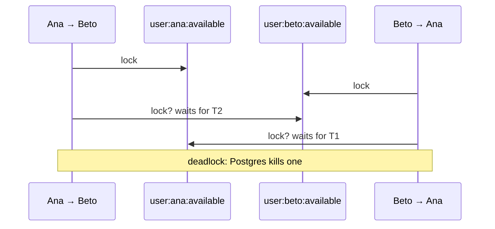

*Without ordering (not what the code does).*

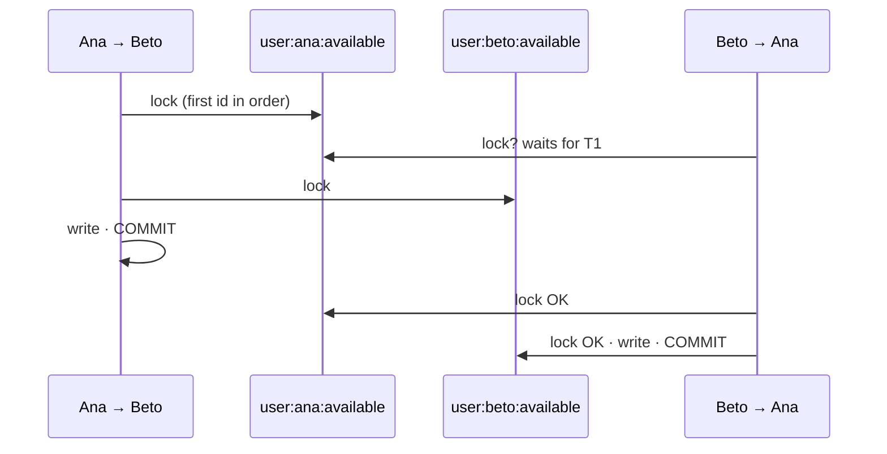

*With `ORDER BY a.id FOR UPDATE` (what the code does).*

## Error handling

Every error ends up in `DomainExceptionFilter`, which always answers with the same JSON shape. The interceptor only stores business errors under the idempotency key.

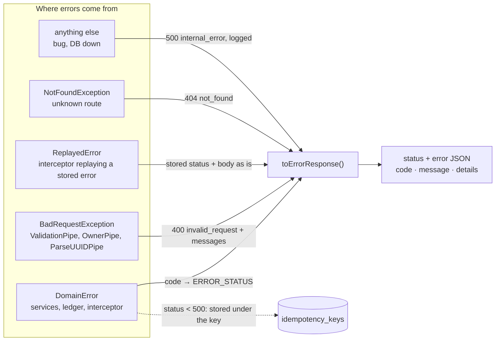

*Only `DomainError` with status < 500 is stored. Validation errors and 500s roll back the key, so the client can retry.*

## Reconciliation

`GET /admin/reconciliation` recomputes everything from the immutable entries and compares it with the `balances` cache. If someone wrote a balance by hand, it shows up here.

```mermaid
flowchart TB
  S["reconcile()"] --> Q1["SELECT sum(amount_cents) FROM entries"]
  S --> Q2["per account:<br/>expected = (debit-normal ? 1 : −1) × sum(its entries)"]
  Q2 --> CMP{"balances.balance_cents<br/>= expected?"}
  CMP -->|no| MM["add to mismatches:<br/>account_id, balance_cents, expected_cents"]
  Q1 --> Z{"total = 0?"}
  Z --> OK["ok = total is 0 AND no mismatches"]
  CMP -->|yes| OK
  MM --> OK
```

*The ledger spec deliberately corrupts `sys:bank` by 1 cent to check that reconciliation catches it.*

## Entry history pagination

`GET /wallets/:owner/entries` uses keyset pagination: instead of `OFFSET`, the client sends the last id it saw. It stays fast and stable even while new entries keep arriving, because entry ids only grow.

```mermaid
sequenceDiagram
  participant C as Client
  participant API as WalletsService.entries
  participant PG as Postgres
  C->>API: GET /entries?limit=4
  API->>PG: WHERE owner = juan ORDER BY id DESC LIMIT 5
  PG-->>API: 5 rows (ids 9..5)
  API-->>C: entries 9..6 · next_cursor = 6
  C->>API: GET /entries?limit=4&before=6
  API->>PG: WHERE owner = juan AND id < 6 ORDER BY id DESC LIMIT 5
  PG-->>API: 2 rows (ids 5..4)
  API-->>C: entries 5..4 · next_cursor = null
```

*It asks for `limit + 1` rows: the extra row only tells it whether there is a next page.*

## Test architecture

Tests run against a real Postgres database (`wallet_test`), because locks and concurrency can't be faked with mocks. Each test file starts from an empty schema.

```mermaid
flowchart TB
  VC["vitest.config.ts / vitest.config.e2e.ts<br/>DATABASE_URL = …/wallet_test<br/>fileParallelism: false"] --> SPEC
  subgraph SPEC[Each spec file · beforeAll]
    R["resetDatabase()<br/>refuses unless the DB name ends in _test<br/>DROP SCHEMA public CASCADE"]
    APP["Test.createTestingModule(AppModule)<br/>app.init() → migrations run"]
    R --> APP
  end
  APP --> U1["ledger.spec.ts<br/>calls LedgerService directly"]
  APP --> U2["wallet.spec.ts<br/>calls services inside tx.run()<br/>fundedWallet() helper"]
  APP --> E["api.e2e-spec.ts<br/>supertest over HTTP<br/>real interceptor, pipes, filter"]
  U1 --> PG[("wallet_test")]
  U2 --> PG
  E --> PG
```

*Files run one at a time because they share one database; inside a file, the concurrency tests still run requests in parallel.*

---

# Manual test cases

Each case uses variables from the previous ones: run them in order, in the same terminal. You need `jq` and `uuidgen`.

```bash
pnpm db:up
pnpm start:dev
```

### Setup

- [ ] **P0 · Session variables** — Owners get a random suffix so you can repeat the session without colliding with wallets you already created.

  ```bash
  B=http://localhost:3000
  A=ana-$RANDOM; M=maria-$RANDOM
  echo $A $M
  ```

  **Expected:** Prints both owners, e.g. ana-1234 maria-5678.

- [ ] **P1 · Health** — The app booted and applied the migration.

  ```bash
  curl -s $B/health
  ```

  **Expected:** {"ok":true}

### Happy path: deposit, hold and payout

- [ ] **F1 · Create a wallet** — Creates 3 accounts: pending, available and held.

  ```bash
  curl -s -w '\n→ %{http_code}\n' -X POST $B/wallets \
    -H "Idempotency-Key: $(uuidgen)" -H 'content-type: application/json' \
    -d "{\"owner\":\"$A\"}"
  ```

  **Expected:** 201 with all three balances at 0.

- [ ] **F2 · Start a $100 ACH deposit** — Entry: debit sys:funding_receivable, credit user:pending.

  ```bash
  DEP=$(curl -s -X POST $B/wallets/$A/deposits \
    -H "Idempotency-Key: $(uuidgen)" -H 'content-type: application/json' \
    -d '{"amount_cents":10000}' | jq -r .id)
  curl -s $B/deposits/$DEP | jq
  ```

  **Expected:** Deposit with status "pending" and amount_cents 10000.

- [ ] **F3 · Balance with the deposit pending** — The money is visible but not spendable yet.

  ```bash
  curl -s $B/wallets/$A | jq
  ```

  **Expected:** pending_cents 10000, available_cents 0.

- [ ] **F4 · Hold against pending money** — Invariant 7: a pending ACH is never spendable.

  ```bash
  curl -s -w '\n→ %{http_code}\n' -X POST $B/wallets/$A/holds \
    -H "Idempotency-Key: $(uuidgen)" -H 'content-type: application/json' \
    -d '{"amount_cents":1000}'
  ```

  **Expected:** 422 insufficient_funds, with balance_cents 0 in details.

- [ ] **F5 · Settle the deposit** — 4-line entry: pending → available, and funding_receivable → bank.

  ```bash
  curl -s -w '\n→ %{http_code}\n' -X POST $B/deposits/$DEP/settle \
    -H "Idempotency-Key: $(uuidgen)"
  curl -s $B/wallets/$A | jq
  ```

  **Expected:** 200 with status "settled"; then available_cents 10000 and pending_cents 0.

- [ ] **F6 · Duplicate webhook** — Settling again, with a different key, is a no-op.

  ```bash
  curl -s -o /dev/null -w '→ %{http_code}\n' -X POST $B/deposits/$DEP/settle \
    -H "Idempotency-Key: $(uuidgen)"
  curl -s $B/wallets/$A | jq .available_cents
  ```

  **Expected:** 200, and available_cents stays at 10000.

- [ ] **F7 · Hold $25 for a payout** — Entry: debit user:available, credit user:held.

  ```bash
  HOLD=$(curl -s -X POST $B/wallets/$A/holds \
    -H "Idempotency-Key: $(uuidgen)" -H 'content-type: application/json' \
    -d '{"amount_cents":2500}' | jq -r .id)
  curl -s $B/wallets/$A | jq
  ```

  **Expected:** available_cents 7500, held_cents 2500.

- [ ] **F8 · Capture the hold** — The payout went out: debit user:held, credit sys:payouts_out.

  ```bash
  curl -s -w '\n→ %{http_code}\n' -X POST $B/holds/$HOLD/capture \
    -H "Idempotency-Key: $(uuidgen)"
  curl -s $B/wallets/$A | jq
  ```

  **Expected:** 200 with status "captured"; then available_cents 7500 and held_cents 0.

- [ ] **F9 · Release a captured hold** — A hold can't go from captured to released.

  ```bash
  curl -s -w '\n→ %{http_code}\n' -X POST $B/holds/$HOLD/release \
    -H "Idempotency-Key: $(uuidgen)"
  ```

  **Expected:** 409 hold_not_active.

- [ ] **F10 · Entry history** — Every movement is a ledger line; effect_cents is the effect from the user's point of view.

  ```bash
  curl -s "$B/wallets/$A/entries?limit=3" \
    | jq '{entries: [.entries[] | {transaction_kind, account, effect_cents}], next_cursor}'
  ```

  **Expected:** 3 lines, the first one hold_captured / held / -2500, and a numeric next_cursor to request the next page with ?before=.

- [ ] **F11 · Reconciliation** — All entries sum to 0 and every balance matches its entries.

  ```bash
  curl -s $B/admin/reconciliation | jq
  ```

  **Expected:** {"ok": true, "system_sum_cents": 0, "mismatches": []}

### Returned ACH

- [ ] **R1 · Return a pending deposit** — A returned ACH only touches pending; available doesn't move.

  ```bash
  DEP2=$(curl -s -X POST $B/wallets/$A/deposits \
    -H "Idempotency-Key: $(uuidgen)" -H 'content-type: application/json' \
    -d '{"amount_cents":3000}' | jq -r .id)
  curl -s -X POST $B/deposits/$DEP2/return -H "Idempotency-Key: $(uuidgen)" | jq .status
  curl -s $B/wallets/$A | jq
  ```

  **Expected:** "returned"; available_cents stays at 7500 and pending_cents at 0.

- [ ] **R2 · Settle a returned deposit** — Invalid transition.

  ```bash
  curl -s -w '\n→ %{http_code}\n' -X POST $B/deposits/$DEP2/settle \
    -H "Idempotency-Key: $(uuidgen)"
  ```

  **Expected:** 409 deposit_not_pending, with status "returned" in details.

### Expired holds

- [ ] **H1 · Hold with a 1-second TTL** — An expired hold can't be captured, but it can be released.

  ```bash
  H2=$(curl -s -X POST $B/wallets/$A/holds \
    -H "Idempotency-Key: $(uuidgen)" -H 'content-type: application/json' \
    -d '{"amount_cents":500,"ttl_seconds":1}' | jq -r .id)
  sleep 2
  curl -s -w '\n→ %{http_code}\n' -X POST $B/holds/$H2/capture -H "Idempotency-Key: $(uuidgen)"
  curl -s -X POST $B/holds/$H2/release -H "Idempotency-Key: $(uuidgen)" | jq .status
  ```

  **Expected:** Capture: 409 hold_expired. Release: "released". available_cents goes back to 7500.

### Transfers

- [ ] **T1 · Transfer $10 to another wallet** — Entry: debit A:available, credit M:available.

  ```bash
  curl -s -o /dev/null -X POST $B/wallets -H "Idempotency-Key: $(uuidgen)" \
    -H 'content-type: application/json' -d "{\"owner\":\"$M\"}"
  curl -s -w '\n→ %{http_code}\n' -X POST $B/transfers \
    -H "Idempotency-Key: $(uuidgen)" -H 'content-type: application/json' \
    -d "{\"from\":\"$A\",\"to\":\"$M\",\"amount_cents\":1000}"
  ```

  **Expected:** 201 with a transaction_id. A ends with 6500 and M with 1000.

- [ ] **T2 · Transfer more than available** — No user account ever goes negative.

  ```bash
  curl -s -w '\n→ %{http_code}\n' -X POST $B/transfers \
    -H "Idempotency-Key: $(uuidgen)" -H 'content-type: application/json' \
    -d "{\"from\":\"$A\",\"to\":\"$M\",\"amount_cents\":999999}"
  ```

  **Expected:** 422 insufficient_funds. Balances don't change.

- [ ] **T3 · Transfer to the same wallet** — Business rule.

  ```bash
  curl -s -w '\n→ %{http_code}\n' -X POST $B/transfers \
    -H "Idempotency-Key: $(uuidgen)" -H 'content-type: application/json' \
    -d "{\"from\":\"$A\",\"to\":\"$A\",\"amount_cents\":100}"
  ```

  **Expected:** 400 invalid_request.

### Idempotency

- [ ] **I1 · Retry with the same key** — Same response, no double effect.

  ```bash
  K=$(uuidgen)
  for i in 1 2; do
    curl -s -i -X POST $B/transfers -H "Idempotency-Key: $K" \
      -H 'content-type: application/json' \
      -d "{\"from\":\"$A\",\"to\":\"$M\",\"amount_cents\":100}" \
      | grep -iE '^HTTP|replayed|transaction_id'
  done
  curl -s $B/wallets/$A | jq .available_cents
  ```

  **Expected:** 201 twice with the same transaction_id; only the second has Idempotent-Replayed: true. A ends with 6400 (money moved once). The replayed body lists the same keys in a different order, because it is stored in a jsonb column; the content is identical.

- [ ] **I2 · Same key, different body** — A key identifies exactly one operation.

  ```bash
  curl -s -w '\n→ %{http_code}\n' -X POST $B/transfers -H "Idempotency-Key: $K" \
    -H 'content-type: application/json' \
    -d "{\"from\":\"$A\",\"to\":\"$M\",\"amount_cents\":200}"
  ```

  **Expected:** 422 idempotency_key_reused.

- [ ] **I3 · POST without Idempotency-Key** — Every POST requires one.

  ```bash
  curl -s -w '\n→ %{http_code}\n' -X POST $B/wallets \
    -H 'content-type: application/json' -d '{"owner":"no-key"}'
  ```

  **Expected:** 400 idempotency_key_required. The wallet is not created.

- [ ] **I4 · Business error retried** — The error is stored under the key: a retry returns it again without re-running the handler.

  ```bash
  K2=$(uuidgen)
  for i in 1 2; do
    curl -s -i -X POST $B/wallets/$A/holds -H "Idempotency-Key: $K2" \
      -H 'content-type: application/json' -d '{"amount_cents":999999}' \
      | grep -iE '^HTTP|replayed'
  done
  ```

  **Expected:** 422 twice; the second one with Idempotent-Replayed: true.

- [ ] **I5 · Two identical requests in parallel** — The second one waits on the key's lock and returns the first one's response.

  ```bash
  K3=$(uuidgen)
  for i in 1 2; do
    curl -s -X POST $B/wallets/$A/holds -H "Idempotency-Key: $K3" \
      -H 'content-type: application/json' -d '{"amount_cents":100}' | jq -r .id &
  done; wait
  curl -s $B/wallets/$A | jq '{available_cents, held_cents}'
  ```

  **Expected:** The same id twice. held_cents only goes up by 100 (to 100) and available_cents drops to 6300.

### Validation and errors

- [ ] **V1 · Invalid amounts** — Only positive integer cents, sent as a number.

  ```bash
  for amt in 10.5 -100 0 '"100"' 1000000001; do
    curl -s -o /dev/null -w "$amt → %{http_code}\n" -X POST $B/wallets/$A/deposits \
      -H "Idempotency-Key: $(uuidgen)" -H 'content-type: application/json' \
      -d "{\"amount_cents\":$amt}"
  done
  ```

  **Expected:** 400 in all five cases.

- [ ] **V2 · Missing resources and malformed input** — 404 for what doesn't exist, 400 for what is malformed.

  ```bash
  curl -s -o /dev/null -w 'unknown wallet → %{http_code}\n' $B/wallets/nobody
  curl -s -o /dev/null -w 'bad uuid → %{http_code}\n' $B/deposits/abc
  curl -s -o /dev/null -w "duplicate wallet → %{http_code}\n" -X POST $B/wallets \
    -H "Idempotency-Key: $(uuidgen)" -H 'content-type: application/json' -d "{\"owner\":\"$A\"}"
  ```

  **Expected:** 404, 400 and 409.

### Concurrency

- [ ] **C1 · 20 parallel holds on $50** — FOR UPDATE serializes the holds: exactly 5 get through.

  ```bash
  W=race-$RANDOM
  curl -s -o /dev/null -X POST $B/wallets -H "Idempotency-Key: $(uuidgen)" \
    -H 'content-type: application/json' -d "{\"owner\":\"$W\"}"
  D=$(curl -s -X POST $B/wallets/$W/deposits -H "Idempotency-Key: $(uuidgen)" \
    -H 'content-type: application/json' -d '{"amount_cents":5000}' | jq -r .id)
  curl -s -o /dev/null -X POST $B/deposits/$D/settle -H "Idempotency-Key: $(uuidgen)"
  seq 20 | xargs -P 20 -I{} curl -s -o /dev/null -w '%{http_code}\n' -X POST \
    $B/wallets/$W/holds -H "Idempotency-Key: $W-{}" \
    -H 'content-type: application/json' -d '{"amount_cents":1000}' | sort | uniq -c
  curl -s $B/wallets/$W | jq '{available_cents, held_cents}'
  ```

  **Expected:** 5 × 201 and 15 × 422. available_cents 0, held_cents 5000.

### Immutable ledger

- [ ] **L1 · Try to delete or edit the ledger** — Database triggers: mistakes are fixed with reversal entries, never by editing.

  ```bash
  docker compose exec -T postgres psql -U wallet -d wallet -c 'delete from entries'
  docker compose exec -T postgres psql -U wallet -d wallet -c 'update journal_transactions set kind = kind'
  ```

  **Expected:** Both fail with ledger_is_append_only.

- [ ] **L2 · Final reconciliation** — After everything above, the ledger still balances.

  ```bash
  curl -s $B/admin/reconciliation | jq
  ```

  **Expected:** ok: true, system_sum_cents: 0, empty mismatches.
