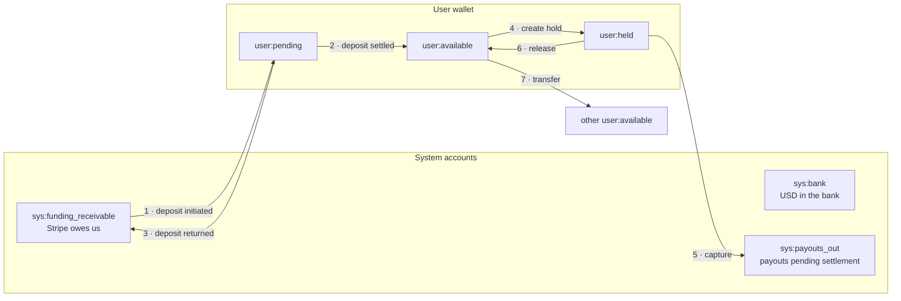

# Accounts and journal entries

Each wallet has three accounts of its own, plus three shared system accounts. A journal transaction moves money between accounts: it always has at least two lines and sums to exactly 0. In the database a positive amount is a **debit** and a negative one is a **credit**.

*Each arrow is a journal transaction: money leaves the source account (debit) and enters the destination (credit). Settlement also moves money from `funding_receivable` to `bank`.*

| # | Operation | Debit (+) | Credit (−) | Journal key |
|---|---|---|---|---|
| 1 | Deposit initiated | `sys:funding_receivable` | `user:pending` | `deposit:<id>:initiated` |
| 2 | Deposit settled | `user:pending` + `sys:bank` | `user:available` + `sys:funding_receivable` | `deposit:<id>:settled` |
| 3 | Deposit returned | `user:pending` | `sys:funding_receivable` | `deposit:<id>:returned` |
| 4 | Create hold | `user:available` | `user:held` | `hold:<id>:created` |
| 5 | Capture hold | `user:held` | `sys:payouts_out` | `hold:<id>:captured` |
| 6 | Release hold | `user:held` | `user:available` | `hold:<id>:released` |
| 7 | Transfer | `userA:available` | `userB:available` | `transfer:<Idempotency-Key>` |

> **Why does a credit increase the user's balance?** User accounts are **credit-normal**: they represent money the platform owes the user, so they grow with credits. `sys:funding_receivable` and `sys:bank` are debit-normal and grow with debits. `LedgerService` turns each line into a balance change according to the account's `normal_side` (see *Balance sign math* in Part 2).

## Journal entries by operation

| Operation | Debit | Credit | Journal key |
|---|---|---|---|
| Deposit initiated | `sys:funding_receivable` | `user:pending` | `deposit:<id>:initiated` |
| Deposit settled | `user:pending` + `sys:bank` | `user:available` + `sys:funding_receivable` | `deposit:<id>:settled` |
| Deposit returned | `user:pending` | `sys:funding_receivable` | `deposit:<id>:returned` |
| Hold created | `user:available` | `user:held` | `hold:<id>:created` |
| Hold captured | `user:held` | `sys:payouts_out` | `hold:<id>:captured` |
| Hold released | `user:held` | `user:available` | `hold:<id>:released` |
| Transfer | `userA:available` | `userB:available` | `transfer:<Idempotency-Key>` |
| Reversal of any transaction | original credits | original debits | `<originalKey>:reversal` |

User accounts (`pending`, `available`, `held`) are credit-normal: money the platform owes the user.
The exception is `user:<owner>:receivable` (debit-normal, never negative): what the user owes the
platform. It's created lazily by `WalletsService.ensureReceivable` inside the transaction that first
needs it, never with the wallet ([ledger foundation](/features/ledger-foundation)).

## Worked example

Juan deposits $100 by ACH, it settles, he holds $25 for a payout and the payout goes out. Amounts in cents. Bold cells are the accounts that change in each step.

| Step | pending | available | held | funding_rec. | bank | payouts_out |
|---|--:|--:|--:|--:|--:|--:|
| Wallet created | 0 | 0 | 0 | 0 | 0 | 0 |
| 1 · Deposit initiated (10,000) | **10,000** | 0 | 0 | **10,000** | 0 | 0 |
| 2 · Deposit settled | **0** | **10,000** | 0 | **0** | **10,000** | 0 |
| 4 · Hold of 2,500 | 0 | **7,500** | **2,500** | 0 | 10,000 | 0 |
| 5 · Hold captured | 0 | 7,500 | **0** | 0 | 10,000 | **2,500** |

At the end the bank holds 10,000: the platform owes Juan 7,500 and 2,500 is committed to the payout. What came in equals what is owed, which is why reconciliation sums to 0.

## Balance sign math

Lines are stored with one sign convention (+ debit, − credit), but each account reports a "natural" balance that is positive when it holds value. The account's `normal_side` translates between the two.

| Account | normal_side | Line | delta | Effect |
|---|---|---|---|---|
| `sys:funding_receivable` | debit | +10,000 (debit) | +10,000 | Stripe owes us more |
| `user:pending` | credit | −10,000 (credit) | +10,000 | User sees money on the way |
| `user:available` | credit | +2,500 (debit) | −2,500 | User has less to spend |
| `user:held` | credit | −2,500 (credit) | +2,500 | Money reserved |
| `sys:payouts_out` | credit | −2,500 (credit) | +2,500 | Payout in flight |

> Rule: `delta = normal_side == 'debit' ? amount : −amount`. Reconciliation uses the same rule in SQL to recompute every balance from scratch.
