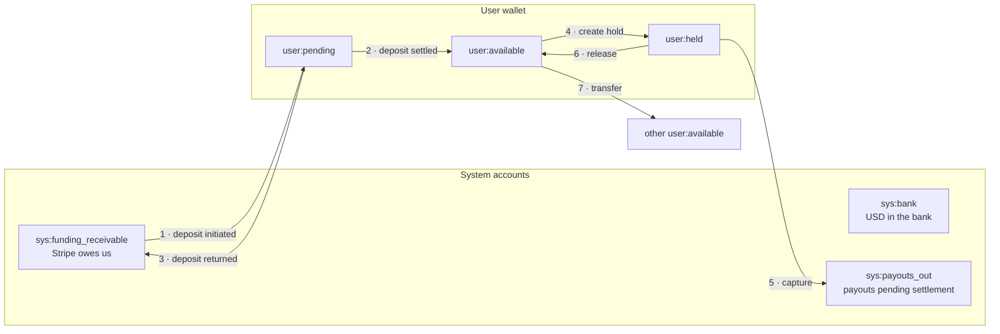

# Accounts and journal entries

Each wallet has **three accounts** (`pending`, `available`, `held`); three **system accounts** are
shared. Every operation is a journal transaction of ≥ 2 lines that **sums to 0**: positive = debit,
negative = credit.

*Each arrow is a journal transaction (source debited, destination credited). Settlement also moves
`funding_receivable` → `bank`.*

## Every operation's entry

| # | Operation | Debit (+) | Credit (−) | Journal key |
|---|---|---|---|---|
| 1 | Deposit initiated | `sys:funding_receivable` | `user:pending` | `deposit:<id>:initiated` |
| 2 | Deposit settled | `user:pending` + `sys:bank` | `user:available` + `sys:funding_receivable` | `deposit:<id>:settled` |
| 3 | Deposit returned | `user:pending` | `sys:funding_receivable` | `deposit:<id>:returned` |
| 4 | Create hold | `user:available` | `user:held` | `hold:<id>:created` |
| 5 | Capture hold | `user:held` | `sys:payouts_out` | `hold:<id>:captured` |
| 6 | Release hold | `user:held` | `user:available` | `hold:<id>:released` |
| 7 | Transfer | `userA:available` | `userB:available` | `transfer:<Idempotency-Key>` |
| 8 | Reversal of any transaction | original credits | original debits | `<originalKey>:reversal` |

- **User accounts are credit-normal**: money the platform owes the user, so a credit increases them
  ([sign math](#balance-sign-math)).
- **Exception:** `user:<owner>:receivable` is debit-normal and never negative: what the user owes the
  platform. Created lazily by `WalletsService.ensureReceivable`, never with the wallet
  ([ledger foundation](/features/ledger-foundation)).

## Worked example

Juan deposits $100 by ACH, it settles, he holds $25 and the payout goes out (cents; bold = changed).

| Step | pending | available | held | funding_rec. | bank | payouts_out |
|---|--:|--:|--:|--:|--:|--:|
| Wallet created | 0 | 0 | 0 | 0 | 0 | 0 |
| 1 · Deposit initiated (10,000) | **10,000** | 0 | 0 | **10,000** | 0 | 0 |
| 2 · Deposit settled | **0** | **10,000** | 0 | **0** | **10,000** | 0 |
| 4 · Hold of 2,500 | 0 | **7,500** | **2,500** | 0 | 10,000 | 0 |
| 5 · Hold captured | 0 | 7,500 | **0** | 0 | 10,000 | **2,500** |

The bank holds 10,000 = 7,500 owed to Juan + 2,500 in the payout. That's why reconciliation sums to 0.

## Balance sign math

Rule: `delta = normal_side == 'debit' ? amount : −amount`. Lines keep one sign convention; each
balance is reported positive when it holds value. Reconciliation recomputes every balance in SQL
with the same rule.

| Account | normal_side | Line | delta | Effect |
|---|---|---|---|---|
| `sys:funding_receivable` | debit | +10,000 (debit) | +10,000 | Stripe owes us more |
| `user:pending` | credit | −10,000 (credit) | +10,000 | money on the way |
| `user:available` | credit | +2,500 (debit) | −2,500 | less to spend |
| `user:held` | credit | −2,500 (credit) | +2,500 | money reserved |
| `sys:payouts_out` | credit | −2,500 (credit) | +2,500 | payout in flight |
