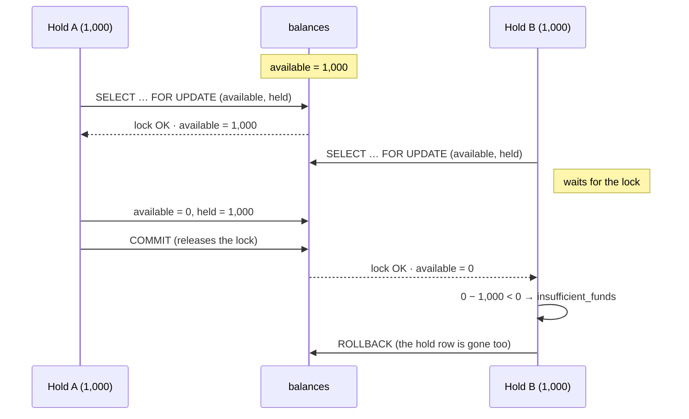
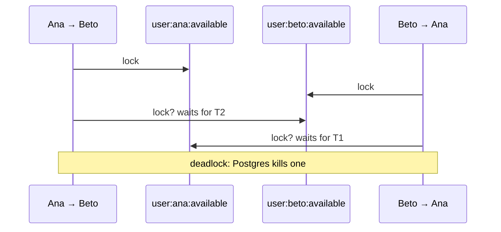
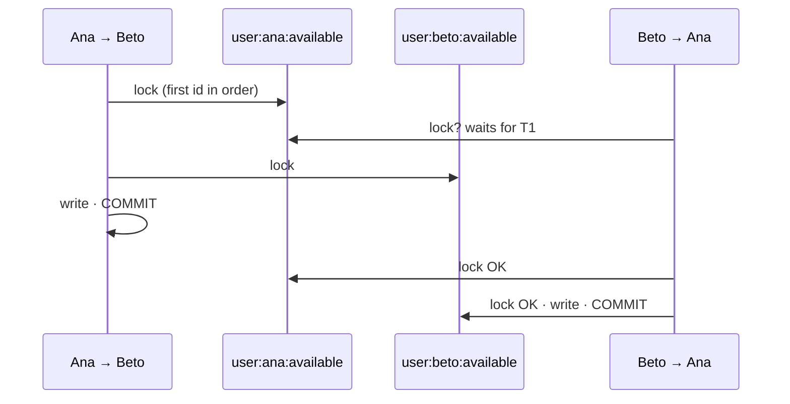

# Concurrency: why it never goes negative

`postTransaction` locks the `balances` rows (`FOR UPDATE`) **before** computing new balances, always **sorted by `account_id`**. Two spends on one wallet run one after the other, and the second sees the real balance.

*The concurrency test fires 50 holds of 1,000 in parallel against 10,000: exactly 10 get through.*

## Why sorted locking prevents deadlocks

Ana → Beto and Beto → Ana at the same time both need both rows. Locking the sender first would
deadlock; locking in `account_id` order makes both start with the same row, so one just waits.

::: details Both orders, step by step

*Without ordering (not what the code does).*

*With `ORDER BY a.id FOR UPDATE` (what the code does).*
:::
