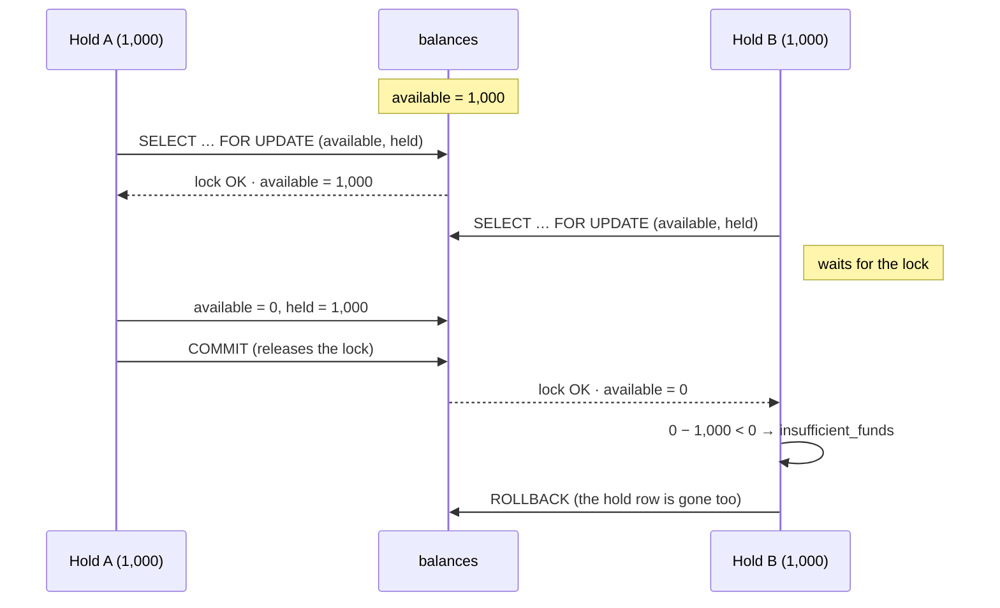
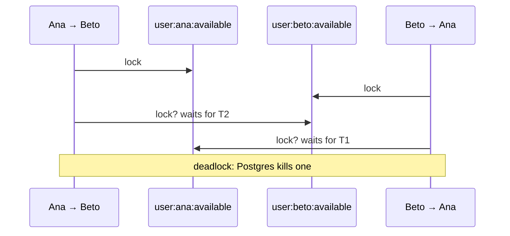
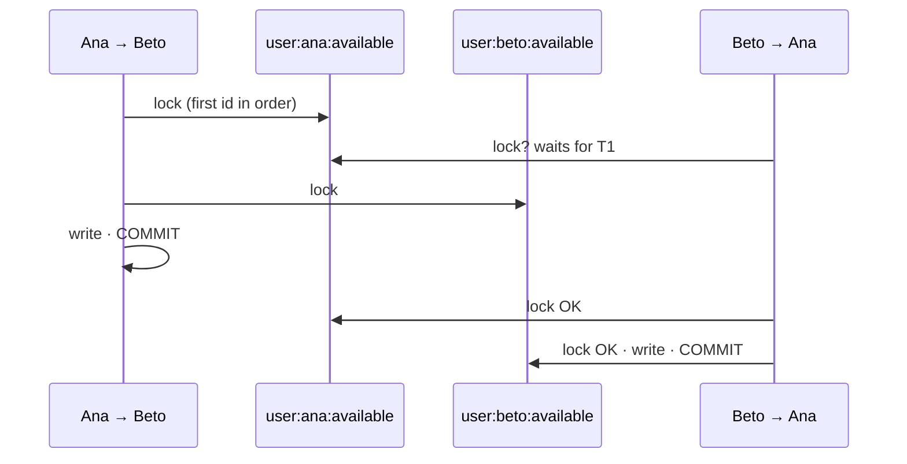

# Concurrency: why it never goes negative

Before computing the new balance, `postTransaction` locks the `balances` rows with `FOR UPDATE`, always sorted by `account_id` so two transactions never lock in crossed order (deadlock). Two holds on the same wallet run one after the other.

*The concurrency test fires 50 holds of 1,000 in parallel against 10,000: exactly 10 get through.*

## Why sorted locking prevents deadlocks

Two transfers in opposite directions at the same time: Ana → Beto and Beto → Ana. Each needs both `available` rows. If each locked its own sender first, they would wait on each other forever. Because `postTransaction` always locks in `account_id` order, both start with the same row, and one simply waits.

*Without ordering (not what the code does).*

*With `ORDER BY a.id FOR UPDATE` (what the code does).*
