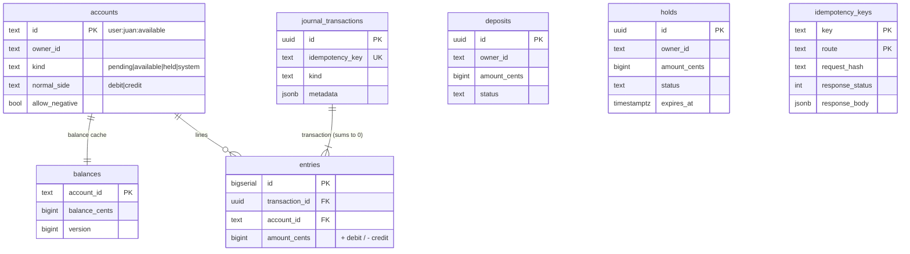

# Data model

Money lives only in the ledger (`entries` + `journal_transactions`, append-only); `balances` is a
cache of it. `deposits` and `holds` track process state, `idempotency_keys` stores responses.

*Triggers reject `UPDATE` and `DELETE` on `entries` and `journal_transactions`.*
