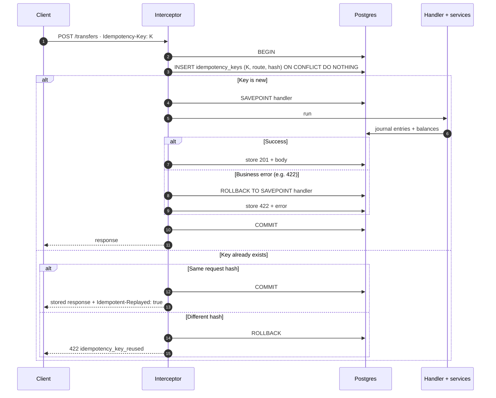

# Idempotency

Key, response and money movements are written in **one transaction**: all or nothing. A retry with the same key gets the stored response and moves no money; a concurrent duplicate waits on the key's `INSERT`, then gets the same response.

- A **500** or a **400** (validation) rolls back everything: the key isn't stored, so the client can retry with a fixed body.
- Second safety net: every journal transaction has its own unique key, so the same entry can't be written twice.
