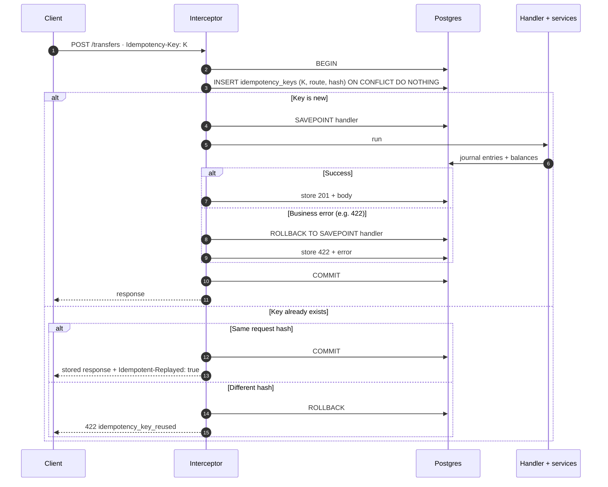

# Idempotency

The key, the response and the money movements are written in **one transaction**: either all of it commits, or none of it. If two requests arrive at once with the same key, the second one waits on the `INSERT` until the first commits, then returns the stored response.

*An unexpected error (500) or a validation error (400) rolls back everything: the key is not stored and the client can retry with a fixed body. On top of that, every journal transaction has its own unique key, a second safety net in case the same entry is attempted twice.*
