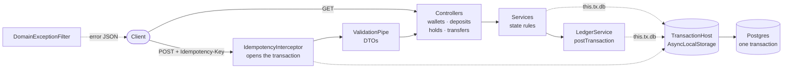

# Architecture

How the wallet is built: every money movement is a double-entry journal transaction in Postgres, and balances are derived from those entries. The overview pages explain the model; the deep-dive pages go file by file through how the app works inside. The [testing](./testing) page ends with manual test cases you can run with `curl`.

## The big picture

A `POST` request first goes through the idempotency interceptor, which opens the Postgres transaction. Everything the controller and services do happens inside that transaction. Services never open connections: they ask `TransactionHost` for the current client, which it keeps in an `AsyncLocalStorage`. `GET` handlers open their own transaction with `tx.run()`.

*Solid line: a call. Dotted line: everything shares the request's single Postgres client.*

## Invariants and where they are enforced

| # | Invariant | Where |
|---|---|---|
| 1 | Amounts are integer cents, never floats | `bigint` in the database; a `pg` parser that rejects values outside `Number.isSafeInteger`; DTOs with `@IsInt` |
| 2 | Every transaction has ≥ 2 lines and sums to 0 | `assertBalanced` in `src/ledger/ledger.service.ts`, before writing |
| 3 | The ledger is append-only | `forbid_mutation` trigger in `migrations/001_init.sql` |
| 4 | Balances are written together with their entries | Same `postTransaction`, same transaction |
| 5 | No user account goes negative, even under concurrency | `FOR UPDATE` sorted by `account_id` + `allow_negative` check |
| 6 | Exactly once per idempotency key | `IdempotencyInterceptor`: key, response and entries in one transaction |
| 7 | A pending ACH is never spendable | Deposits credit `user:pending`; holds and transfers only debit `user:available` |

---

## Reading guide

**Overview**

- [Accounts and journal entries](./accounts-and-entries): the chart of accounts, a worked example, and the sign convention.
- [Deposit and hold states](./state-machines): the state machines and the journal lines each transition writes.
- [Idempotency](./idempotency): how a retried `POST` returns the stored response and moves no money.
- [Concurrency](./concurrency): row locks in a fixed order, and why that rules out deadlocks.
- [Data model](./data-model): tables, constraints and append-only triggers.

**Deep dive**

- [How it maps to the real world](./real-world): ACH, card holds and what the system accounts stand for.
- [Inside the Nest app](./nest-internals): project map, module graph, request lifecycle, boot and shutdown, `TransactionHost`.
- [postTransaction and full traces](./post-transaction): the core write path, step by step, through real operations.
- [Errors, reconciliation and pagination](./operations)
- [Testing](./testing): how the suite runs against real Postgres, plus manual test cases with `curl`.

For *why* it is built this way, see the [decision records](/decisions/).
