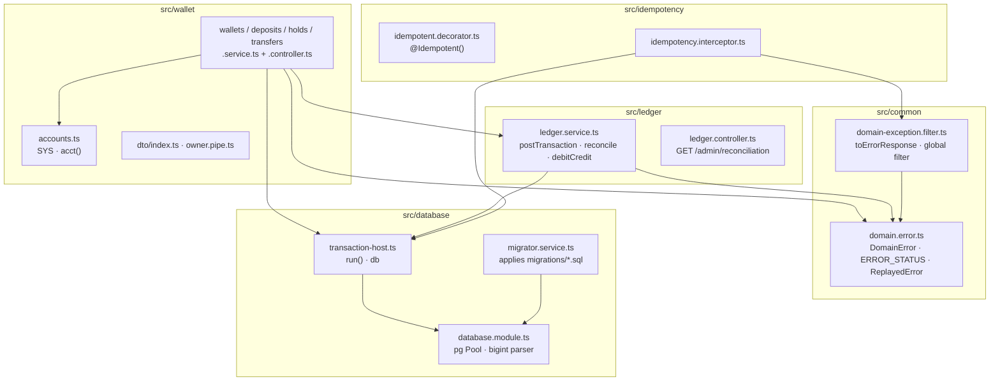
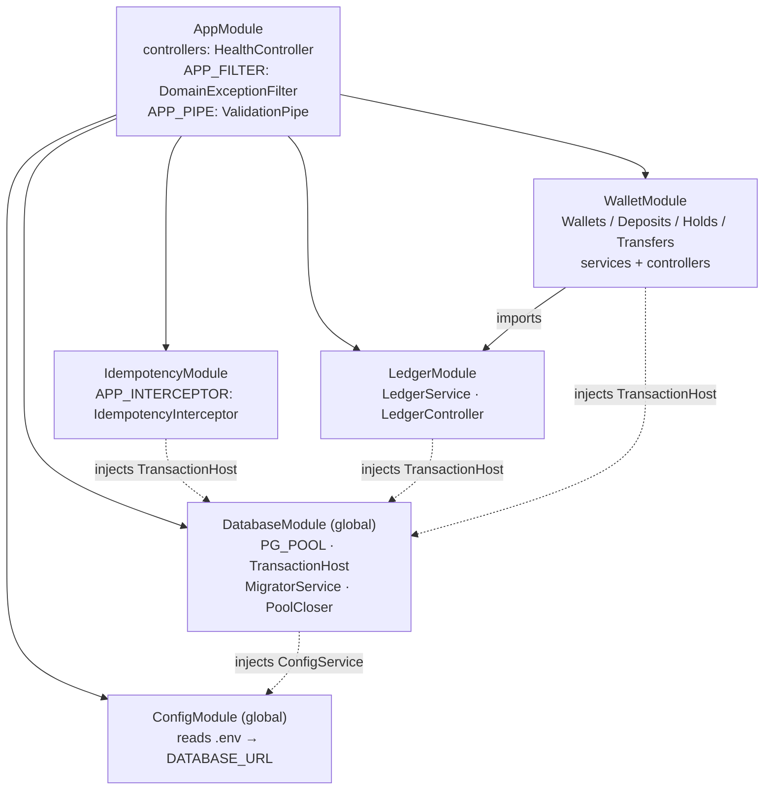
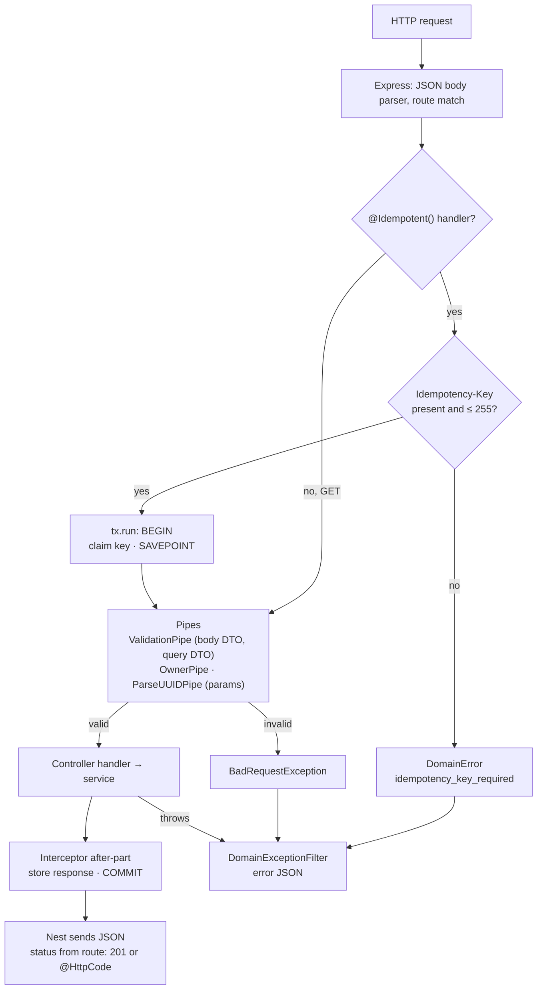
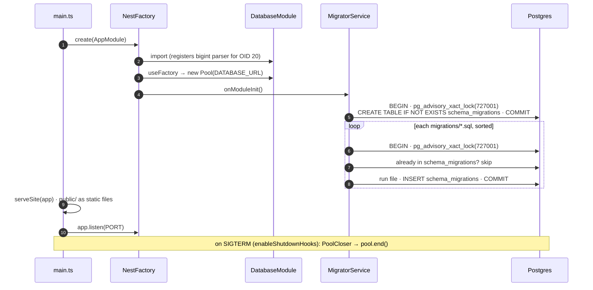
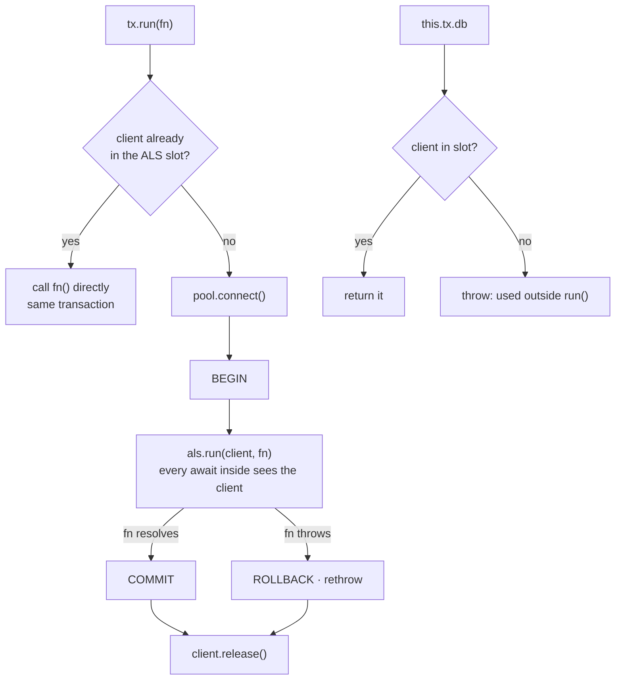
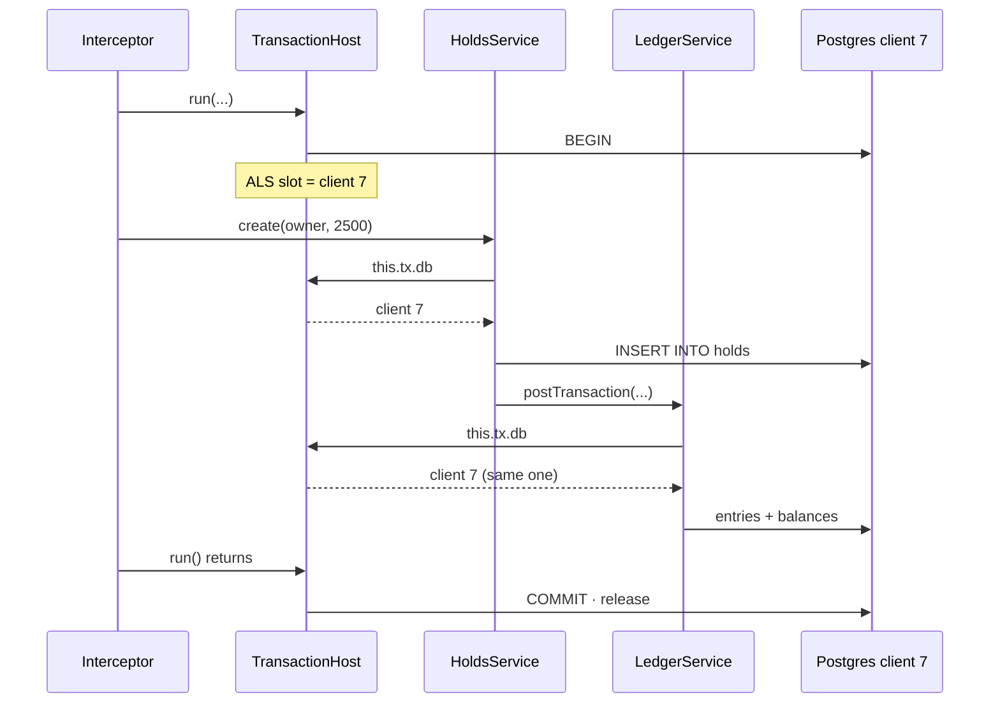

# Inside the Nest app

## Project map

Each folder in `src/` owns one concern. Arrows show who depends on whom: the wallet depends on the ledger, the ledger depends on the database, and nothing depends on the wallet.

*`src/health` (GET /health) and `main.ts` / `app.module.ts` are left out to keep the picture readable.*

## Nest module graph

`AppModule` wires everything. `ConfigModule` and `DatabaseModule` are global, so any provider can inject `ConfigService`, `PG_POOL` or `TransactionHost` without importing them. The filter, the validation pipe and the interceptor are registered as `APP_*` providers, which makes them apply to every route, in tests too.

*Solid line: `imports`. Dotted line: injection through a global module.*

## Request lifecycle inside Nest

Nest runs a fixed pipeline for every request. The important detail: **pipes run inside `next.handle()`**, so the interceptor's transaction is already open when validation runs, and a validation error travels back through the interceptor's `catch`. That is why the interceptor decides what to store by error type.

*Guards and middleware exist in Nest but this app doesn't use them (no auth yet).*

## Boot and shutdown

`pnpm start:dev` builds the module graph, creates the pool, runs pending migrations in `onModuleInit` and only then starts listening. Each migration runs in its own transaction that takes a transaction-scoped advisory lock and re-checks `schema_migrations`, so two instances booting at once (or two test files) apply each file exactly once. Because no lock outlives a transaction, this also works through a transaction-mode pooler such as PgBouncer or Neon's pooled URL.

*Migrations are tracked by file name. To change the schema, add a new `NNN_….sql`; never edit an applied file.*

On Vercel, `onModuleInit` skips migrations: the build step runs `pnpm db:migrate` instead, because functions don't ship the `migrations/` folder. `main.ts` also doesn't `await bootstrap()` at the top level: on Vercel, `listen` resolves only after the entry module has finished loading, so awaiting it deadlocks the function's init (see [ADR 0008](/decisions/0008-serverless-on-vercel)).

## TransactionHost and AsyncLocalStorage

`AsyncLocalStorage` gives each request its own invisible "context slot" that follows every `await`. `run()` puts the transaction's client in that slot; anything called inside reads it with `this.tx.db`. If `run()` is called while a transaction is already open, it reuses it instead of opening a second one.

*Concurrent requests each get their own slot, so 50 parallel holds are 50 separate transactions.*

*Nobody passes the client around as an argument, yet every query lands in the same transaction.*
