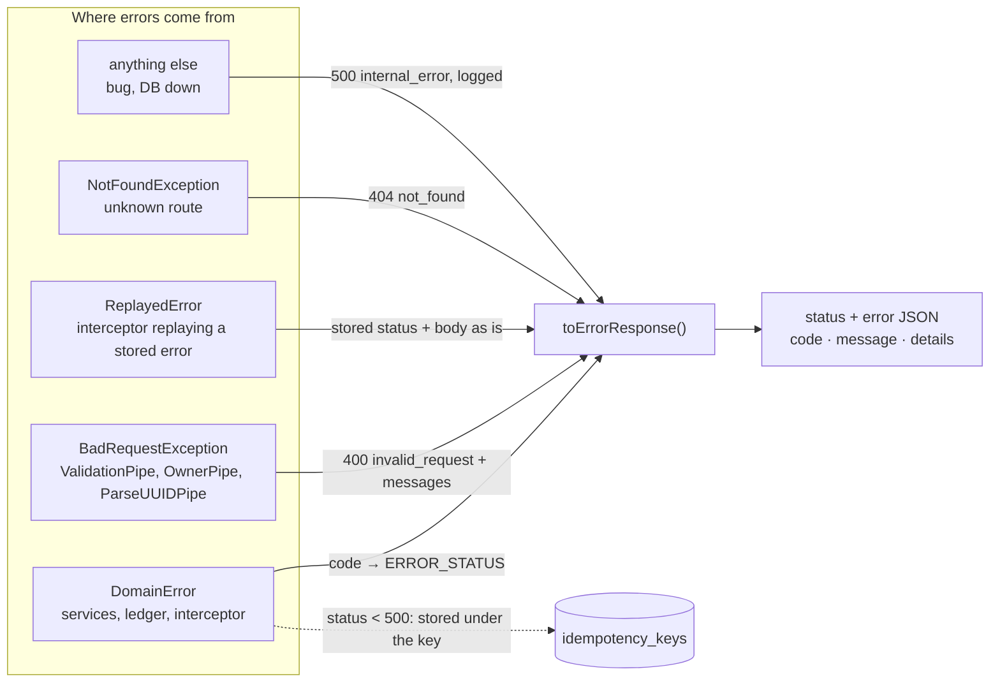
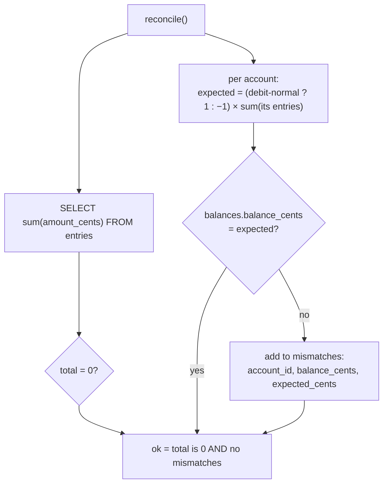
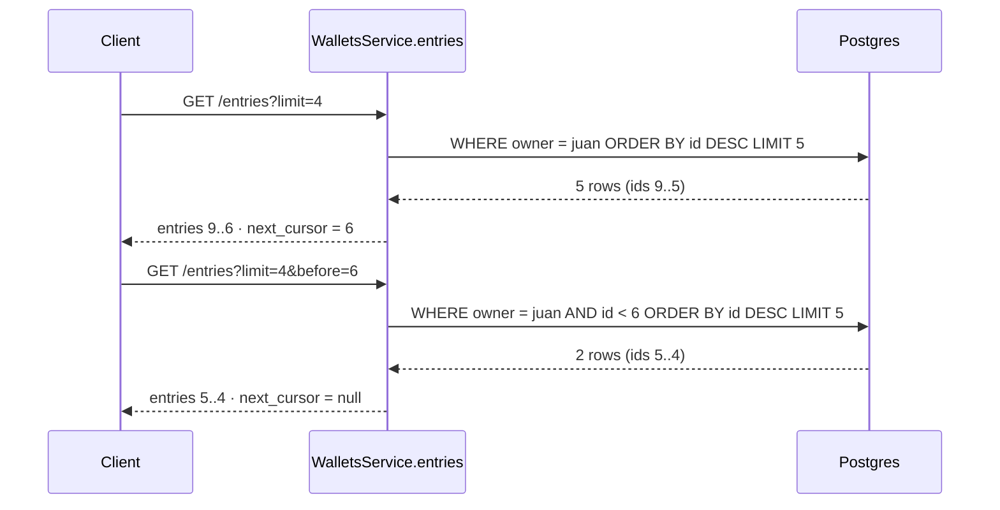

# Errors, reconciliation and pagination

- **Errors:** one filter, one JSON shape (`code · message · details`); only business errors are stored under the idempotency key.
- **Reconciliation:** `GET /admin/reconciliation` recomputes every balance from the entries and lists mismatches.
- **Pagination:** entry history uses a cursor (`before=<id>`), not `OFFSET`.

## Error handling

*Only `DomainError` with status < 500 is stored. Validation errors and 500s roll back the key, so the client can retry.*

## Reconciliation

Compares the `balances` cache with what the immutable entries say. A hand-edited balance shows up as a mismatch.

*The ledger spec deliberately corrupts `sys:bank` by 1 cent to check that reconciliation catches it.*

## Entry history pagination

`GET /wallets/:owner/entries`: the client sends the last id it saw. Entry ids only grow, so pages stay fast and stable while new entries arrive.

*It asks for `limit + 1` rows: the extra row only tells it whether there is a next page.*
