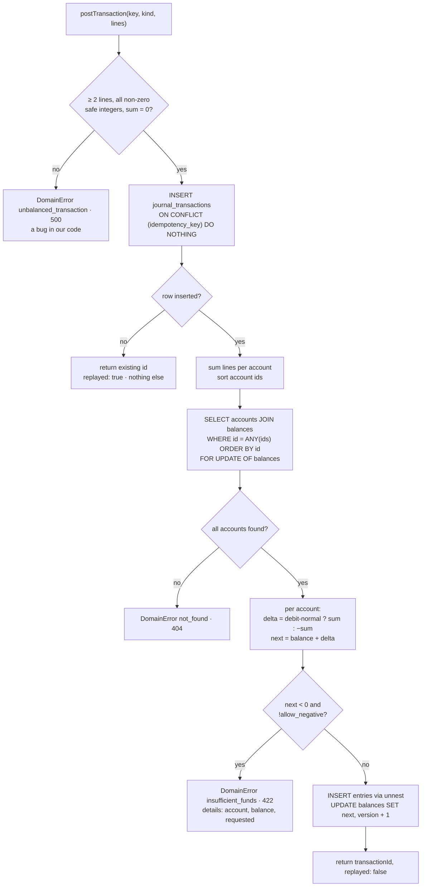
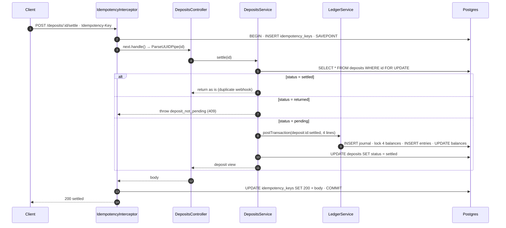
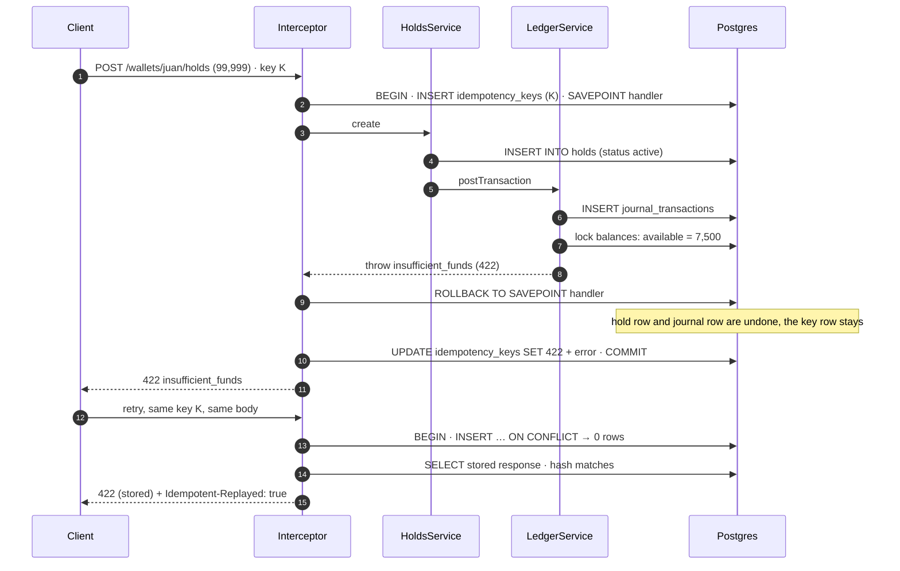

# postTransaction and full traces

`postTransaction(key, kind, lines)` is the **only** way money moves: check the lines sum to 0,
claim the journal key, lock balances in order, refuse negatives, write entries and balances.
Any error aborts the surrounding transaction, so nothing is ever half-written.

## postTransaction step by step

*An error after the journal `INSERT` rolls it back too (transaction or savepoint).*

## Full trace: settling a deposit

One `POST /deposits/:id/settle`, from request to commit.

*The deposit row lock (step 5) is what makes two simultaneous webhooks safe: the second one waits, then sees `settled`.*

## Full trace: a hold without funds

A failed hold leaves nothing behind; the retry gets the same 422 without running again.

*The savepoint is the trick: it lets the interceptor undo the handler's writes while keeping its own key row.*
