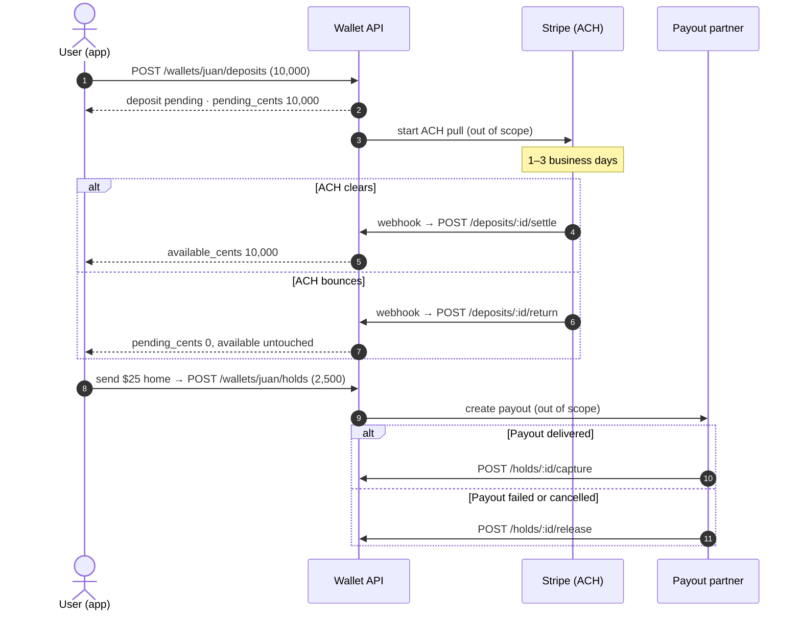

# How it maps to the real world

The API is the wallet core of a remittance app: **Stripe** pulls USD by ACH (takes days, can bounce) and a **payout partner** delivers it abroad. Each real-world event calls one endpoint:

*Stripe and the payout partner are simulated: in this project you call those endpoints yourself (or the tests do).*
