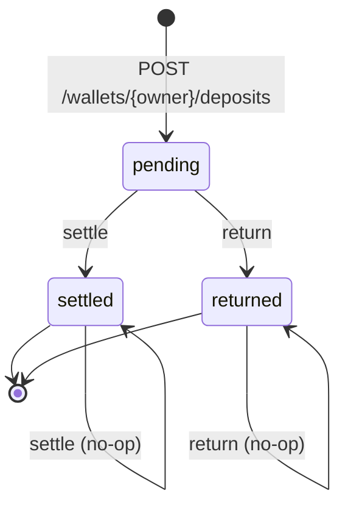
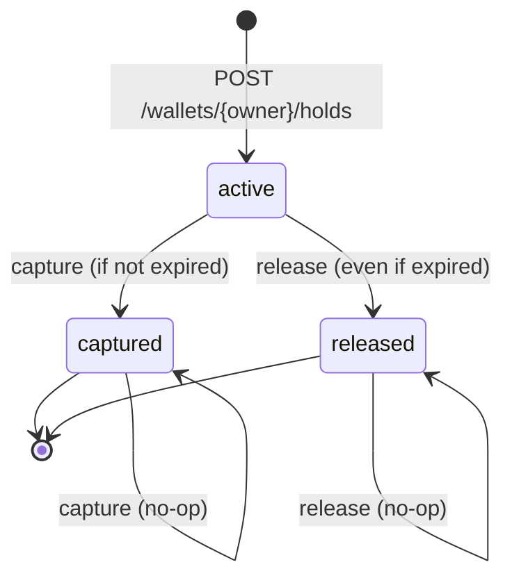

# Deposit and hold states

Each transition locks the row (`FOR UPDATE`). Repeating the current state (a duplicate webhook) is a **no-op**; any other invalid transition is a **409**.

*Deposit. Settling a returned one, or returning a settled one: `409 deposit_not_pending`.*

*Hold. 15-minute TTL by default. Capturing an expired one: `409 hold_expired`. Crossing states: `409 hold_not_active`.*
