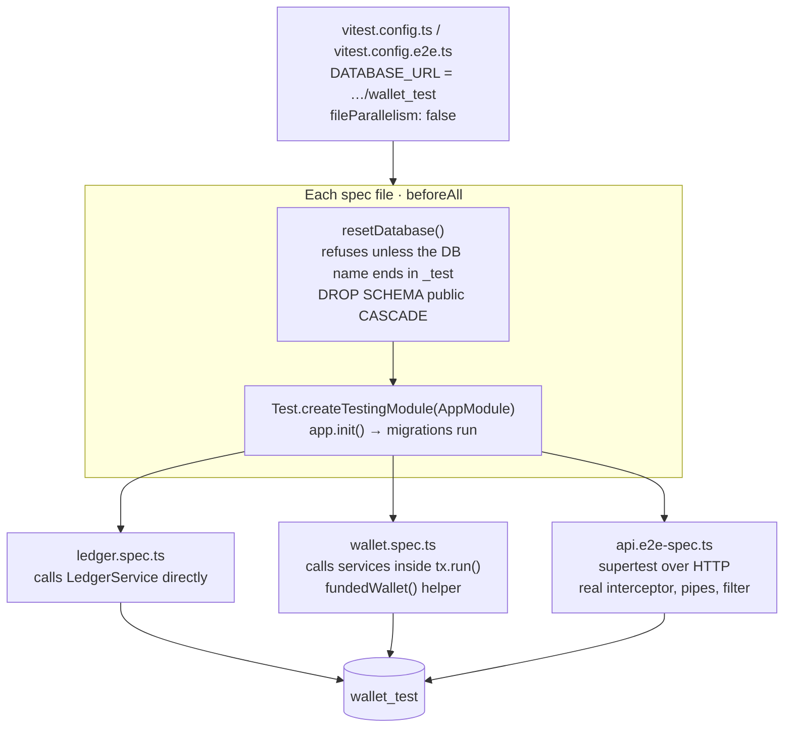

# Testing

## Test architecture

Tests run against a real Postgres database (`wallet_test`), because locks and concurrency can't be faked with mocks. Each test file starts from an empty schema.



*Files run one at a time because they share one database; inside a file, the concurrency tests still run requests in parallel.*

---

## Manual test cases

Each case uses variables from the previous ones: run them in order, in the same terminal. You need `jq` and `uuidgen`.

```bash
pnpm db:up
pnpm start:dev
```

### Setup

- [ ] **P0 · Session variables** — Owners get a random suffix so you can repeat the session without colliding with wallets you already created.

  ```bash
  B=http://localhost:3000
  A=ana-$RANDOM; M=maria-$RANDOM
  echo $A $M
  ```

  **Expected:** Prints both owners, e.g. ana-1234 maria-5678.

- [ ] **P1 · Health** — The app booted and applied the migration.

  ```bash
  curl -s $B/health
  ```

  **Expected:** {"ok":true}

### Happy path: deposit, hold and payout

- [ ] **F1 · Create a wallet** — Creates 3 accounts: pending, available and held.

  ```bash
  curl -s -w '\n→ %{http_code}\n' -X POST $B/wallets \
    -H "Idempotency-Key: $(uuidgen)" -H 'content-type: application/json' \
    -d "{\"owner\":\"$A\"}"
  ```

  **Expected:** 201 with all three balances at 0.

- [ ] **F2 · Start a $100 ACH deposit** — Entry: debit sys:funding_receivable, credit user:pending.

  ```bash
  DEP=$(curl -s -X POST $B/wallets/$A/deposits \
    -H "Idempotency-Key: $(uuidgen)" -H 'content-type: application/json' \
    -d '{"amount_cents":10000}' | jq -r .id)
  curl -s $B/deposits/$DEP | jq
  ```

  **Expected:** Deposit with status "pending" and amount_cents 10000.

- [ ] **F3 · Balance with the deposit pending** — The money is visible but not spendable yet.

  ```bash
  curl -s $B/wallets/$A | jq
  ```

  **Expected:** pending_cents 10000, available_cents 0.

- [ ] **F4 · Hold against pending money** — Invariant 7: a pending ACH is never spendable.

  ```bash
  curl -s -w '\n→ %{http_code}\n' -X POST $B/wallets/$A/holds \
    -H "Idempotency-Key: $(uuidgen)" -H 'content-type: application/json' \
    -d '{"amount_cents":1000}'
  ```

  **Expected:** 422 insufficient_funds, with balance_cents 0 in details.

- [ ] **F5 · Settle the deposit** — 4-line entry: pending → available, and funding_receivable → bank.

  ```bash
  curl -s -w '\n→ %{http_code}\n' -X POST $B/deposits/$DEP/settle \
    -H "Idempotency-Key: $(uuidgen)"
  curl -s $B/wallets/$A | jq
  ```

  **Expected:** 200 with status "settled"; then available_cents 10000 and pending_cents 0.

- [ ] **F6 · Duplicate webhook** — Settling again, with a different key, is a no-op.

  ```bash
  curl -s -o /dev/null -w '→ %{http_code}\n' -X POST $B/deposits/$DEP/settle \
    -H "Idempotency-Key: $(uuidgen)"
  curl -s $B/wallets/$A | jq .available_cents
  ```

  **Expected:** 200, and available_cents stays at 10000.

- [ ] **F7 · Hold $25 for a payout** — Entry: debit user:available, credit user:held.

  ```bash
  HOLD=$(curl -s -X POST $B/wallets/$A/holds \
    -H "Idempotency-Key: $(uuidgen)" -H 'content-type: application/json' \
    -d '{"amount_cents":2500}' | jq -r .id)
  curl -s $B/wallets/$A | jq
  ```

  **Expected:** available_cents 7500, held_cents 2500.

- [ ] **F8 · Capture the hold** — The payout went out: debit user:held, credit sys:payouts_out.

  ```bash
  curl -s -w '\n→ %{http_code}\n' -X POST $B/holds/$HOLD/capture \
    -H "Idempotency-Key: $(uuidgen)"
  curl -s $B/wallets/$A | jq
  ```

  **Expected:** 200 with status "captured"; then available_cents 7500 and held_cents 0.

- [ ] **F9 · Release a captured hold** — A hold can't go from captured to released.

  ```bash
  curl -s -w '\n→ %{http_code}\n' -X POST $B/holds/$HOLD/release \
    -H "Idempotency-Key: $(uuidgen)"
  ```

  **Expected:** 409 hold_not_active.

- [ ] **F10 · Entry history** — Every movement is a ledger line; effect_cents is the effect from the user's point of view.

  ```bash
  curl -s "$B/wallets/$A/entries?limit=3" \
    | jq '{entries: [.entries[] | {transaction_kind, account, effect_cents}], next_cursor}'
  ```

  **Expected:** 3 lines, the first one hold_captured / held / -2500, and a numeric next_cursor to request the next page with ?before=.

- [ ] **F11 · Reconciliation** — All entries sum to 0 and every balance matches its entries.

  ```bash
  curl -s $B/admin/reconciliation | jq
  ```

  **Expected:** {"ok": true, "system_sum_cents": 0, "mismatches": []}

### Returned ACH

- [ ] **R1 · Return a pending deposit** — A returned ACH only touches pending; available doesn't move.

  ```bash
  DEP2=$(curl -s -X POST $B/wallets/$A/deposits \
    -H "Idempotency-Key: $(uuidgen)" -H 'content-type: application/json' \
    -d '{"amount_cents":3000}' | jq -r .id)
  curl -s -X POST $B/deposits/$DEP2/return -H "Idempotency-Key: $(uuidgen)" | jq .status
  curl -s $B/wallets/$A | jq
  ```

  **Expected:** "returned"; available_cents stays at 7500 and pending_cents at 0.

- [ ] **R2 · Settle a returned deposit** — Invalid transition.

  ```bash
  curl -s -w '\n→ %{http_code}\n' -X POST $B/deposits/$DEP2/settle \
    -H "Idempotency-Key: $(uuidgen)"
  ```

  **Expected:** 409 deposit_not_pending, with status "returned" in details.

### Expired holds

- [ ] **H1 · Hold with a 1-second TTL** — An expired hold can't be captured, but it can be released.

  ```bash
  H2=$(curl -s -X POST $B/wallets/$A/holds \
    -H "Idempotency-Key: $(uuidgen)" -H 'content-type: application/json' \
    -d '{"amount_cents":500,"ttl_seconds":1}' | jq -r .id)
  sleep 2
  curl -s -w '\n→ %{http_code}\n' -X POST $B/holds/$H2/capture -H "Idempotency-Key: $(uuidgen)"
  curl -s -X POST $B/holds/$H2/release -H "Idempotency-Key: $(uuidgen)" | jq .status
  ```

  **Expected:** Capture: 409 hold_expired. Release: "released". available_cents goes back to 7500.

### Transfers

- [ ] **T1 · Transfer $10 to another wallet** — Entry: debit A:available, credit M:available.

  ```bash
  curl -s -o /dev/null -X POST $B/wallets -H "Idempotency-Key: $(uuidgen)" \
    -H 'content-type: application/json' -d "{\"owner\":\"$M\"}"
  curl -s -w '\n→ %{http_code}\n' -X POST $B/transfers \
    -H "Idempotency-Key: $(uuidgen)" -H 'content-type: application/json' \
    -d "{\"from\":\"$A\",\"to\":\"$M\",\"amount_cents\":1000}"
  ```

  **Expected:** 201 with a transaction_id. A ends with 6500 and M with 1000.

- [ ] **T2 · Transfer more than available** — No user account ever goes negative.

  ```bash
  curl -s -w '\n→ %{http_code}\n' -X POST $B/transfers \
    -H "Idempotency-Key: $(uuidgen)" -H 'content-type: application/json' \
    -d "{\"from\":\"$A\",\"to\":\"$M\",\"amount_cents\":999999}"
  ```

  **Expected:** 422 insufficient_funds. Balances don't change.

- [ ] **T3 · Transfer to the same wallet** — Business rule.

  ```bash
  curl -s -w '\n→ %{http_code}\n' -X POST $B/transfers \
    -H "Idempotency-Key: $(uuidgen)" -H 'content-type: application/json' \
    -d "{\"from\":\"$A\",\"to\":\"$A\",\"amount_cents\":100}"
  ```

  **Expected:** 400 invalid_request.

### Idempotency

- [ ] **I1 · Retry with the same key** — Same response, no double effect.

  ```bash
  K=$(uuidgen)
  for i in 1 2; do
    curl -s -i -X POST $B/transfers -H "Idempotency-Key: $K" \
      -H 'content-type: application/json' \
      -d "{\"from\":\"$A\",\"to\":\"$M\",\"amount_cents\":100}" \
      | grep -iE '^HTTP|replayed|transaction_id'
  done
  curl -s $B/wallets/$A | jq .available_cents
  ```

  **Expected:** 201 twice with the same transaction_id; only the second has Idempotent-Replayed: true. A ends with 6400 (money moved once). The replayed body lists the same keys in a different order, because it is stored in a jsonb column; the content is identical.

- [ ] **I2 · Same key, different body** — A key identifies exactly one operation.

  ```bash
  curl -s -w '\n→ %{http_code}\n' -X POST $B/transfers -H "Idempotency-Key: $K" \
    -H 'content-type: application/json' \
    -d "{\"from\":\"$A\",\"to\":\"$M\",\"amount_cents\":200}"
  ```

  **Expected:** 422 idempotency_key_reused.

- [ ] **I3 · POST without Idempotency-Key** — Every POST requires one.

  ```bash
  curl -s -w '\n→ %{http_code}\n' -X POST $B/wallets \
    -H 'content-type: application/json' -d '{"owner":"no-key"}'
  ```

  **Expected:** 400 idempotency_key_required. The wallet is not created.

- [ ] **I4 · Business error retried** — The error is stored under the key: a retry returns it again without re-running the handler.

  ```bash
  K2=$(uuidgen)
  for i in 1 2; do
    curl -s -i -X POST $B/wallets/$A/holds -H "Idempotency-Key: $K2" \
      -H 'content-type: application/json' -d '{"amount_cents":999999}' \
      | grep -iE '^HTTP|replayed'
  done
  ```

  **Expected:** 422 twice; the second one with Idempotent-Replayed: true.

- [ ] **I5 · Two identical requests in parallel** — The second one waits on the key's lock and returns the first one's response.

  ```bash
  K3=$(uuidgen)
  for i in 1 2; do
    curl -s -X POST $B/wallets/$A/holds -H "Idempotency-Key: $K3" \
      -H 'content-type: application/json' -d '{"amount_cents":100}' | jq -r .id &
  done; wait
  curl -s $B/wallets/$A | jq '{available_cents, held_cents}'
  ```

  **Expected:** The same id twice. held_cents only goes up by 100 (to 100) and available_cents drops to 6300.

### Validation and errors

- [ ] **V1 · Invalid amounts** — Only positive integer cents, sent as a number.

  ```bash
  for amt in 10.5 -100 0 '"100"' 1000000001; do
    curl -s -o /dev/null -w "$amt → %{http_code}\n" -X POST $B/wallets/$A/deposits \
      -H "Idempotency-Key: $(uuidgen)" -H 'content-type: application/json' \
      -d "{\"amount_cents\":$amt}"
  done
  ```

  **Expected:** 400 in all five cases.

- [ ] **V2 · Missing resources and malformed input** — 404 for what doesn't exist, 400 for what is malformed.

  ```bash
  curl -s -o /dev/null -w 'unknown wallet → %{http_code}\n' $B/wallets/nobody
  curl -s -o /dev/null -w 'bad uuid → %{http_code}\n' $B/deposits/abc
  curl -s -o /dev/null -w "duplicate wallet → %{http_code}\n" -X POST $B/wallets \
    -H "Idempotency-Key: $(uuidgen)" -H 'content-type: application/json' -d "{\"owner\":\"$A\"}"
  ```

  **Expected:** 404, 400 and 409.

### Concurrency

- [ ] **C1 · 20 parallel holds on $50** — FOR UPDATE serializes the holds: exactly 5 get through.

  ```bash
  W=race-$RANDOM
  curl -s -o /dev/null -X POST $B/wallets -H "Idempotency-Key: $(uuidgen)" \
    -H 'content-type: application/json' -d "{\"owner\":\"$W\"}"
  D=$(curl -s -X POST $B/wallets/$W/deposits -H "Idempotency-Key: $(uuidgen)" \
    -H 'content-type: application/json' -d '{"amount_cents":5000}' | jq -r .id)
  curl -s -o /dev/null -X POST $B/deposits/$D/settle -H "Idempotency-Key: $(uuidgen)"
  seq 20 | xargs -P 20 -I{} curl -s -o /dev/null -w '%{http_code}\n' -X POST \
    $B/wallets/$W/holds -H "Idempotency-Key: $W-{}" \
    -H 'content-type: application/json' -d '{"amount_cents":1000}' | sort | uniq -c
  curl -s $B/wallets/$W | jq '{available_cents, held_cents}'
  ```

  **Expected:** 5 × 201 and 15 × 422. available_cents 0, held_cents 5000.

### Immutable ledger

- [ ] **L1 · Try to delete or edit the ledger** — Database triggers: mistakes are fixed with reversal entries, never by editing.

  ```bash
  docker compose exec -T postgres psql -U wallet -d wallet -c 'delete from entries'
  docker compose exec -T postgres psql -U wallet -d wallet -c 'update journal_transactions set kind = kind'
  ```

  **Expected:** Both fail with ledger_is_append_only.

- [ ] **L2 · Final reconciliation** — After everything above, the ledger still balances.

  ```bash
  curl -s $B/admin/reconciliation | jq
  ```

  **Expected:** ok: true, system_sum_cents: 0, empty mismatches.
