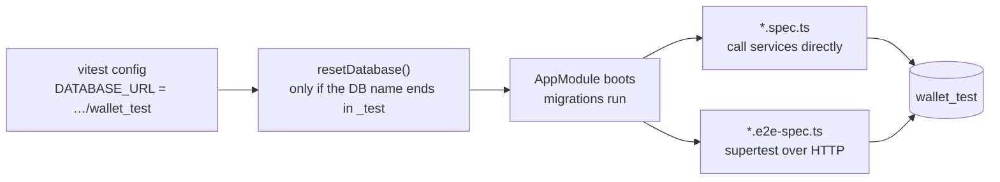

# Testing

Every test runs against a **real Postgres** (`wallet_test`): locks, triggers and concurrency can't
be faked with mocks. Each guarantee in the README has a test that tries to break it.

| Guarantee | Proven by |
|---|---|
| **Never negative** | 50 parallel holds on 10,000 → exactly 10 succeed (`wallet.spec`); a reversal of spent money fails with nothing written (`foundation.spec`) |
| **All or nothing** | a failed hold leaves no orphan row; a rolled-back transaction leaves no receivable (`wallet.spec`, `foundation.spec`) |
| **Exactly once** | same key → same response, money moves once, even for two parallel requests (`api.e2e-spec`) |
| **Always reconciles** | `reconcile().ok` at the end of every suite; `UPDATE`/`DELETE` on entries fail (`ledger.spec`) |
| **Survives load** | the [load simulator](./test-inventory#load-simulation) checks every invariant under conflicting traffic (`load.e2e-spec`) |

```bash
pnpm test        # ledger, wallet, foundation, tooling (needs pnpm db:up)
pnpm test:e2e    # over HTTP with supertest (needs public/ built)
pnpm load        # load simulator against a running API
```

Full list per file, the load simulator and a manual `curl` session: **[Test inventory](./test-inventory)**.

## How a test run works



- Each spec file starts from an empty schema (`DROP SCHEMA public CASCADE`).
- Files run one at a time (`fileParallelism: false`) because they share one database; the
  concurrency tests still fire requests in parallel inside a file.
- E2E tests go through the real interceptor, pipes and error filter. Why real Postgres:
  [ADR 0009](../decisions/0009-tests-against-real-postgres).
