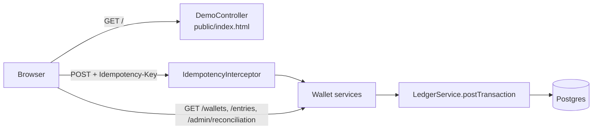

# Demo web page

## What problem it solves

The API is easy to test but hard to *see*. The demo page lets someone who has never read the code
watch the ledger rules hold: money is never created or lost, a balance never goes negative, and a
retried request never moves money twice.

It is one static HTML file with no build step and no dependencies, served by the API at `/`. It only
calls the public endpoints, so it adds no new behaviour to the backend.

## What's on the page

| Panel | Shows |
|---|---|
| Wallets | Create wallets; each card shows the available balance |
| Wallet | `available` / `pending` / `held`; deposit, hold and transfer forms; the journal lines each action writes; deposits (settle / return), holds (capture / release); the latest ledger entries |
| HTTP log | Every call with status, latency and the response body. **Replay** re-sends a `POST` with the same `Idempotency-Key`: the response is marked `replayed` and no money moves |
| Reconciliation badge | `GET /admin/reconciliation`, refreshed after every action, and every 30 s only while the tab is visible (it scans the whole ledger) |
| Stress test | Same idea as `scripts/load.ts`, from the browser: 3 fresh wallets, concurrent conflicting transfers, holds and duplicate requests, then 5 invariant checks |

Amounts are typed in dollars but parsed as text into integer cents (`"12.50"` → `1250`), so the page
never does float arithmetic on money either. Each deposit, hold and transfer form keeps one
`Idempotency-Key` until the server answers and ignores submits while a request is in flight, so a
double-click can't move money twice.



## Try it

```bash
pnpm db:up
pnpm start:dev
# open http://localhost:3000/
```

```bash
curl -s http://localhost:3000/ | grep -o '<title>.*</title>'
# <title>Wallet Ledger</title>
```

## Tests that prove it

| Behaviour | Test |
|---|---|
| `GET /` serves the page as HTML | `api.e2e-spec.ts` › GET / serves the demo page |

The page itself was checked end to end in Chromium (Playwright, not part of CI): create two wallets,
deposit and settle, transfer, an overdraft (422 shown as a toast), hold and capture, replay of a
transfer (marked `replayed`, balance unchanged), and a 300-operation stress test with all invariants
holding; no horizontal scroll at 390 px wide.

## Limitations

- Anyone who can open the page can create wallets and "settle" deposits: the settle / return
  endpoints stand in for bank webhooks and have no auth. Fine for a demo, not for production.
- Deposits and holds created from the page are remembered in the browser (`localStorage`); the API
  has no endpoint to list them.
- The stress test is capped at 1,000 operations and 50 concurrent requests per click; there is no
  server-side rate limiting.
