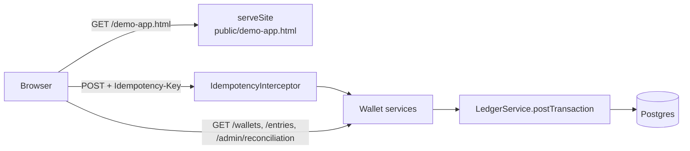

# Demo web page

**Status:** implemented · **Try it:** [/demo](/demo) · **Code:** `docs/public/demo-app.html`

One dependency-free HTML page that lets anyone **see** the ledger rules hold: money is never
created or lost, balances never go negative, a retry never moves money twice. It only calls the
public API.

## What problem it solves

The API is easy to test but hard to *see*. The page is embedded on the [docs site](./docs-site) at
`/demo` and also served alone at `/demo-app.html`; it adds no backend behaviour.

## What's on the page

| Panel | Shows |
|---|---|
| Wallets | Create wallets; each card shows the available balance |
| Wallet | `available` / `pending` / `held`; deposit, hold and transfer forms; the journal lines each action writes; deposits (settle / return), holds (capture / release); the latest ledger entries |
| HTTP log | Every call with status, latency and the response body. **Replay** re-sends a `POST` with the same `Idempotency-Key`: the response is marked `replayed` and no money moves |
| Reconciliation badge | `GET /admin/reconciliation`, refreshed after every action, and every 30 s only while the tab is visible (it scans the whole ledger) |
| Stress test | Same idea as `scripts/load.ts`, from the browser: 3 fresh wallets, concurrent conflicting transfers, holds and duplicate requests, then 5 invariant checks |

- Dollars are parsed **as text** into cents (`"12.50"` → `1250`): no float math on money.
- Each form keeps one `Idempotency-Key` until the server answers and ignores double submits.



## Try it

```bash
pnpm db:up
pnpm build
pnpm start:prod
# open http://localhost:3000/demo
```

```bash
curl -s http://localhost:3000/demo-app.html | grep -o '<title>.*</title>'
# <title>Wallet Ledger</title>
```

## Tests that prove it

| Behaviour | Test |
|---|---|
| The page is served as HTML | `api.e2e-spec.ts` › serves the demo app as a static page |

Also checked end to end in Chromium (Playwright, not in CI): wallets, deposit/settle, transfer,
overdraft toast, hold/capture, replay (balance unchanged), a 300-operation stress test, and no
horizontal scroll at 390 px.

## Limitations

- Anyone can create wallets and "settle" deposits: settle/return stand in for bank webhooks, with no auth.
- Deposits and holds are remembered in `localStorage`; the API can't list them.
- Stress test capped at 1,000 operations / 50 concurrent per click; no server-side rate limiting.
