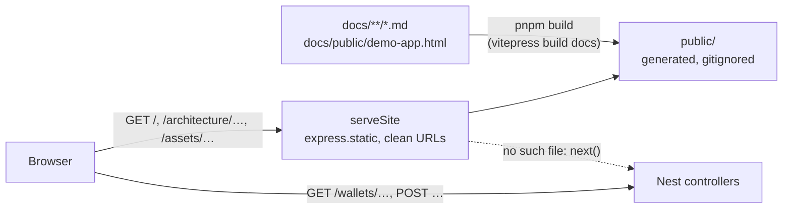
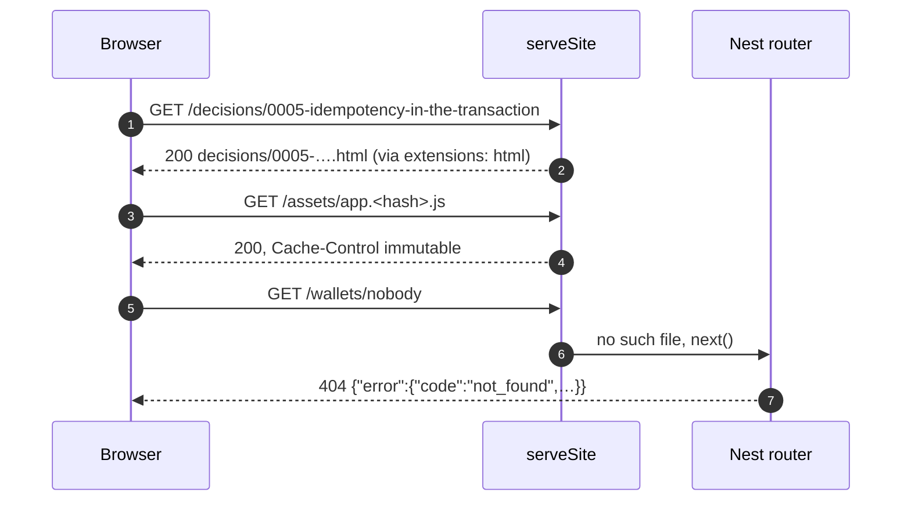

# Docs site

**Status:** implemented · **Decision:** [ADR 0010](/decisions/0010-docs-site-vitepress) · **Code:**
`docs/.vitepress/`, `src/site.ts`, `scripts/check-site.mjs`

VitePress builds the markdown in `docs/` into `public/`, and the NestJS app serves it **next to the
API**: one source, one deployment, one origin (the demo needs no CORS).

## What problem it solves

The *why* of the project lived in markdown nobody visiting the deployment saw, and the architecture
doc had a hand-kept HTML copy that was drifting. Now the markdown **is** the site, with navigation,
search, dark mode and rendered diagrams.

## How it works



| Piece | Where | What it does |
|---|---|---|
| Site config | `docs/.vitepress/config.ts` | Nav, sidebars, local search, output to `public/`, GitHub-style heading ids, the `mermaid` fence |
| Theme hook | `docs/.vitepress/theme/index.ts` | Draws Mermaid diagrams in the browser, importing Mermaid only on pages that have one; redraws on light/dark switch |
| Static serving | `src/site.ts` | `useStaticAssets(public/, { extensions: ['html'] })`, used by `main.ts` and the e2e test app; hashed `assets/` get `immutable` caching |
| Diagram zoom | `docs/.vitepress/theme/diagram-zoom.ts` | Click (or tap) a diagram to open it full screen: wheel, `+`/`-`/`0` keys, buttons or pinch to zoom, drag to pan, Esc to close |
| Page layout | `theme/custom.css` | Every doc page gets the same column, up to 1100 px instead of VitePress' 688 px, so moving between sections doesn't shift the layout; tables and diagrams use the full width, running text stays at ~760 px; the outline aside shows only from 1800 px wide. The nav search box is 240–360 px wide |
| Link check | `scripts/check-site.mjs` (`pnpm docs:check`, in CI) | Reads the built HTML and fails on internal links to a missing page or a missing `#anchor`; VitePress' own check covers pages only |
| Demo | `docs/public/demo-app.html`, `docs/demo.md` | The existing single-file demo, copied as is and embedded in an iframe at `/demo` |

Only existing files are served, so API routes are unaffected: `/wallets/nobody` falls through to
the controller.



::: details Design notes: Mermaid loading, diagram width, heading ids
- **Mermaid is ~2 MB.** A plugin made every page preload ~50 chunks; the theme hook loads it only on
  pages with a diagram (pages without one load 3 modules).
- **Width.** In VitePress' default 688 px column, wide sequence diagrams drew at ~60% (~9 px text);
  they now render at 92–100% on a 1440 px screen, and any diagram opens full screen.
- **Heading ids** follow GitHub's algorithm (`## 11. Decisions` → `#11-decisions`), so the same
  anchors work on GitHub and on the site.
:::

## Try it

```bash
pnpm db:up
pnpm build        # nest build + vitepress build docs → public/
pnpm start:prod   # the API and the site on http://localhost:3000
```

Writing docs: `pnpm docs:dev` (hot reload on :5173; its demo has no API, so use :3000 for that).

Verified against a running server:

```bash
curl -s http://localhost:3000/ | grep -o '<title>[^<]*</title>'
# <title>Wallet Ledger</title>

curl -s http://localhost:3000/decisions/0005-idempotency-in-the-transaction | grep -o '<title>[^<]*</title>'
# <title>0005 · Idempotency inside the same transaction | Wallet Ledger</title>

curl -s -o /dev/null -w '%{http_code} %{content_type}\n' http://localhost:3000/demo-app.html
# 200 text/html; charset=utf-8

curl -sI http://localhost:3000/assets/$(ls public/assets | grep '^style.*css$') | grep -i '^cache-control'
# Cache-Control: public, max-age=31536000, s-maxage=31536000, immutable

curl -sI http://localhost:3000/ | grep -i '^cache-control'
# Cache-Control: public, max-age=0

curl -s http://localhost:3000/wallets/nobody
# {"error":{"code":"not_found","message":"wallet nobody not found"}}
```

## Tests that prove it

| Behaviour | Test |
|---|---|
| `/` and clean URLs (`/demo`) serve the built pages | `api.e2e-spec.ts` › serves the docs site at / and its pages by clean URL |
| The demo is served as a static page | `api.e2e-spec.ts` › serves the demo app as a static page |
| Hashed assets are cached forever, pages are not | `api.e2e-spec.ts` › caches hashed site assets forever, pages not |
| API routes still answer when no file matches | `api.e2e-spec.ts` › API routes still win over the site |
| Every internal link and anchor in the built site resolves | `pnpm docs:check` (CI step after `pnpm build`) |

The e2e tests read `public/`, so build first (CI does). Also crawled in Chromium (Playwright, not
in CI): every page 200, links and anchors resolve, diagrams render and zoom (wheel, keys, pinch),
no sideways scroll at 390 px, and the embedded demo works against the API.

## Limitations

- On Vercel, HTML pages are served by the function (one invocation per view); hashed assets are CDN-cached.
- The demo keeps its own styles and follows the OS light/dark setting, not the site's toggle.
- The manual test cases ([Test inventory](/architecture/test-inventory)) have no progress checkboxes, unlike the old HTML copy.
