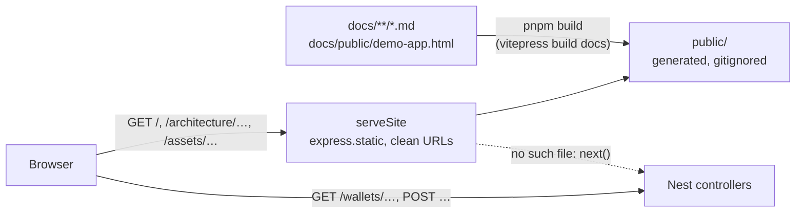
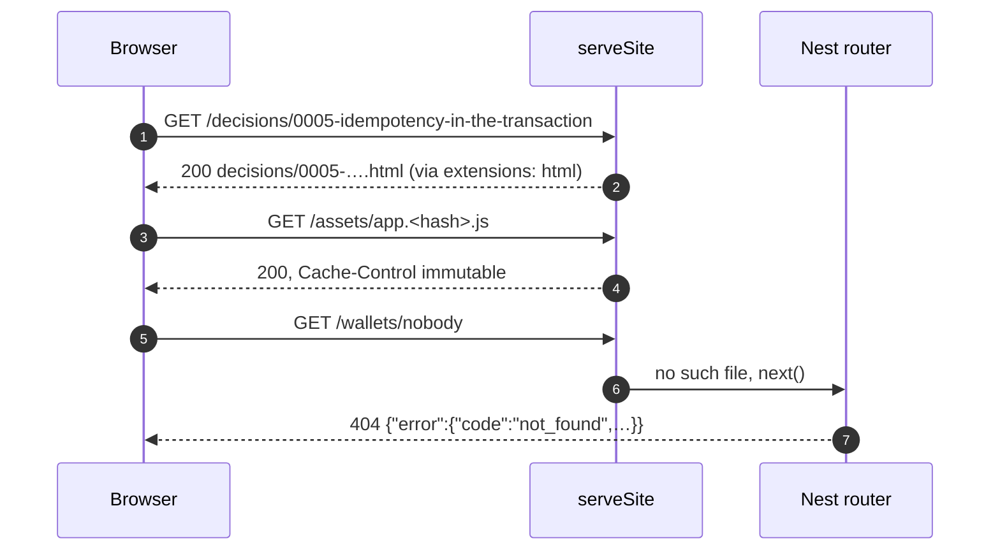

# Docs site

## What problem it solves

The interesting part of this project is *why* it's built the way it is, and that lived in markdown
files nobody visiting the deployment would ever see: the public URL showed one demo page. The
architecture document also existed twice (markdown plus a hand-kept HTML copy), and the copies were
starting to drift.

The docs site puts everything on the deployment, from a single source: the markdown in `docs/` is
the site. It adds a landing page, the live demo, the architecture split into readable pages,
[architecture decision records](/decisions/), the feature pages and the roadmap, with navigation,
search, dark mode and rendered diagrams.

## How it works

VitePress builds `docs/` into `public/` during `pnpm build`. The NestJS app serves that folder as
static files next to the API, so there is one deployment and one origin (the demo calls the API
without CORS).



| Piece | Where | What it does |
|---|---|---|
| Site config | `docs/.vitepress/config.ts` | Nav, sidebars, local search, output to `public/`, GitHub-style heading ids, the `mermaid` fence |
| Theme hook | `docs/.vitepress/theme/index.ts` | Draws Mermaid diagrams in the browser, importing Mermaid only on pages that have one; redraws on light/dark switch |
| Static serving | `src/site.ts` | `useStaticAssets(public/, { extensions: ['html'] })`, used by `main.ts` and the e2e test app; hashed `assets/` get `immutable` caching |
| Demo | `docs/public/demo-app.html`, `docs/demo.md` | The existing single-file demo, copied as is and embedded in an iframe at `/demo` |

Only files that exist are served, so API routes are unaffected; a request for `/wallets/nobody`
falls through to the controller.



Mermaid is about 2 MB. A plugin was tried first, but it made **every** page preload about 50
Mermaid chunks; the theme hook replaced it, and pages without diagrams load 3 modules.

Heading ids follow GitHub's algorithm (`## 11. Decisions` → `#11-decisions`), so links like
`00-ledger-foundation.md#3-account-naming-convention` work both on GitHub and on the site.

## Try it

```bash
pnpm db:up
pnpm build        # nest build + vitepress build docs → public/
pnpm start:prod   # the API and the site on http://localhost:3000
```

For writing docs, `pnpm docs:dev` runs VitePress with hot reload on http://localhost:5173 (the
demo there has no API behind it; use `start:dev` alongside or open the demo on :3000).

Verified against a running server:

```bash
curl -s http://localhost:3000/ | grep -o '<title>[^<]*</title>'
# <title>Wallet Ledger</title>

curl -s http://localhost:3000/decisions/0005-idempotency-in-the-transaction | grep -o '<title>[^<]*</title>'
# <title>0005 · Idempotency inside the same transaction | Wallet Ledger</title>

curl -s -o /dev/null -w '%{http_code} %{content_type}\n' http://localhost:3000/demo-app.html
# 200 text/html; charset=utf-8

curl -sI http://localhost:3000/assets/$(ls public/assets | grep '^style.*css$') | grep -i '^cache-control'
# Cache-Control: public, max-age=31536000, s-maxage=31536000, immutable

curl -sI http://localhost:3000/ | grep -i '^cache-control'
# Cache-Control: public, max-age=0

curl -s http://localhost:3000/wallets/nobody
# {"error":{"code":"not_found","message":"wallet nobody not found"}}
```

## Tests that prove it

| Behaviour | Test |
|---|---|
| `/` and clean URLs (`/demo`) serve the built pages | `api.e2e-spec.ts` › serves the docs site at / and its pages by clean URL |
| The demo is served as a static page | `api.e2e-spec.ts` › serves the demo app as a static page |
| Hashed assets are cached forever, pages are not | `api.e2e-spec.ts` › caches hashed site assets forever, pages not |
| API routes still answer when no file matches | `api.e2e-spec.ts` › API routes still win over the site |

The e2e tests read `public/`, so they need `pnpm build` (or `pnpm docs:build`) first; CI builds
before testing. The site was also crawled in Chromium (Playwright, not part of CI): all 31 pages
return 200, every internal link and `#anchor` resolves, every Mermaid diagram renders without a
syntax error, no page scrolls sideways at 390 px, and the embedded demo creates a wallet, deposits
and settles against the API with the ledger reconciling.

## Limitations

- On Vercel the HTML pages are served by the NestJS function, not straight from the CDN: each page
  view is a function invocation. Hashed assets carry `s-maxage`, so the CDN can cache them.
- The demo keeps its own styles and follows the OS light/dark setting, not the site's toggle.
- The manual test cases (in [Testing](/architecture/testing)) are plain lists; the old HTML copy had
  checkboxes to track progress, which the site doesn't.
