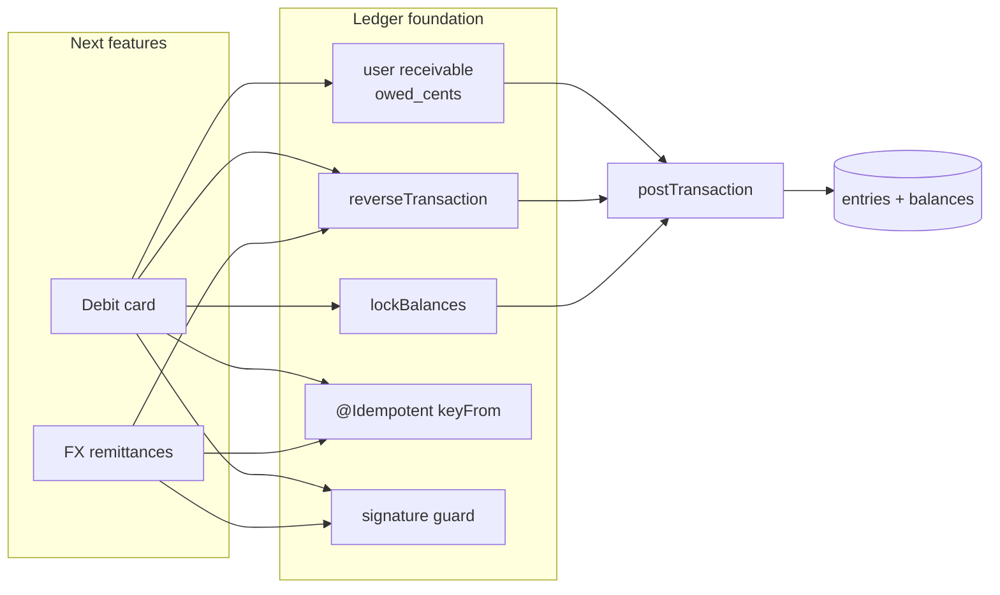
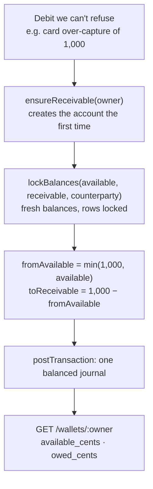
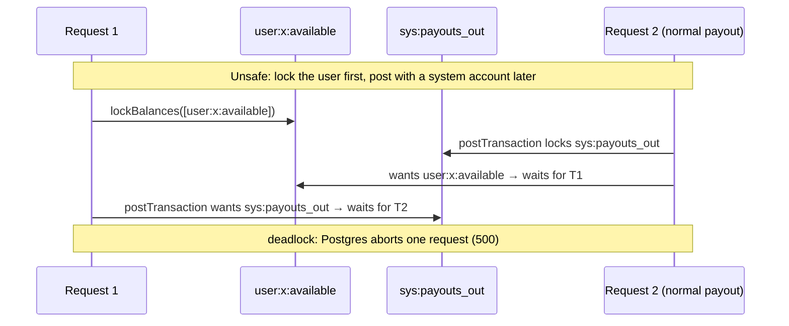
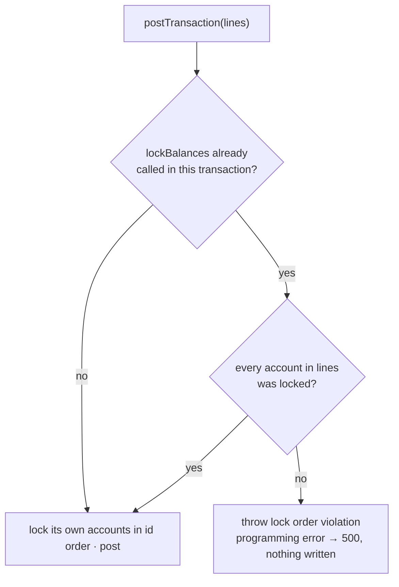
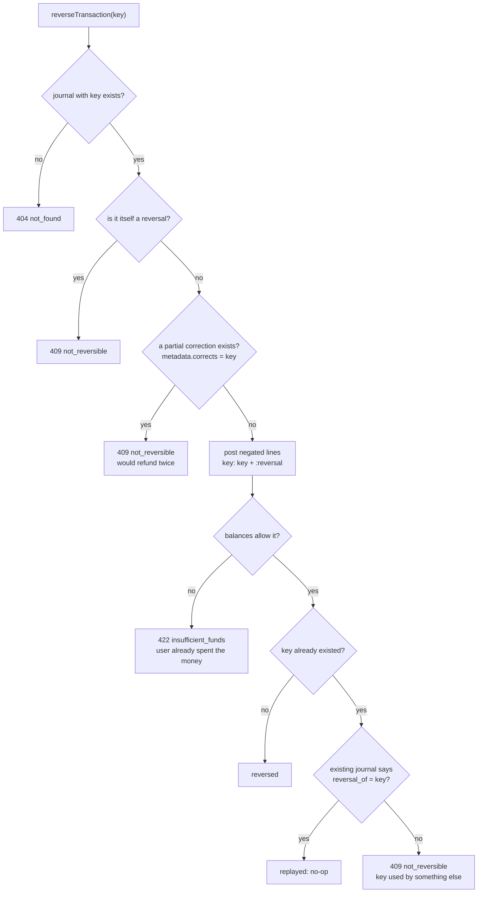
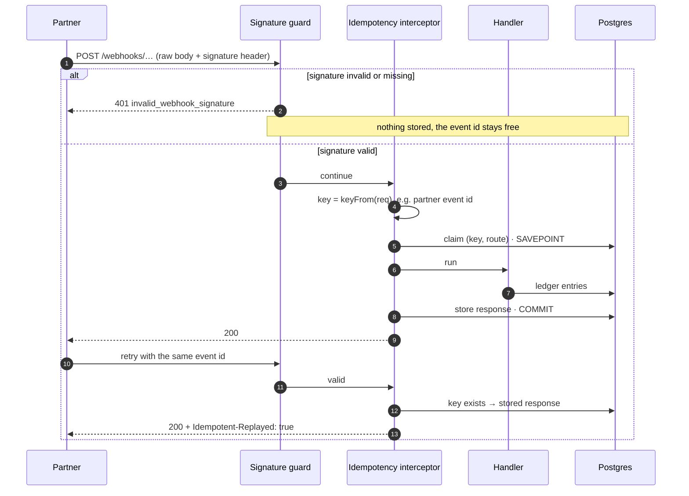

# Ledger foundation (Phase 0)

**Status:** implemented · **Requirements:** [`00-ledger-foundation.md`](../requirements/00-ledger-foundation.md)
· **Code:** `src/ledger/ledger.service.ts`, `src/database/transaction-host.ts`,
`src/wallet/wallets.service.ts`, `src/idempotency/`, `src/webhooks/signature.ts`

## What problem it solves

FX remittances and debit cards both need ledger tools the wallet didn't have. This phase builds them
once, so neither feature reinvents them.

| Business problem | Tool added | Without it |
|---|---|---|
| The card network settles more than was authorized (tip, gas station) and we can't refuse it | Per-user **receivable** (`owed_cents`) | The user's balance would go negative, or we'd lose the money silently |
| A payout fails after the money already left the user's balance | **`reverseTransaction`** | Someone would be tempted to edit entries, which breaks the audit trail |
| Deciding how to split a debit needs fresh balances | **`lockBalances`** | Two requests could read the same balance and both spend it |
| Partners (Stripe, Lithic, payout partner) retry webhooks with their own event id, not our header | **`@Idempotent({ keyFrom })`** | A retried webhook could move money twice |
| Anyone can call a webhook URL | **Signature guard** (HMAC over the raw body) | A forged "payout delivered" call could be stored as a real one |

None of this adds endpoints yet: it is the toolbox the next features use. The only visible API
change is `owed_cents` in `GET /wallets/:owner`.

## Where it fits



## 1. Splitting a debit with the receivable

When a debit can't be refused, the part the user can't cover goes to `user:<owner>:receivable`
("the user owes the platform"). `available` never goes negative.



Worked example: the user has 300 available and the network settles 1,000.

| Line | Account | Debit (+) / Credit (−) | Balance after |
|---|---|--:|--:|
| 1 | `user:x:available` | +300 | 0 |
| 2 | `user:x:receivable` | +700 | 700 owed |
| 3 | counterparty (e.g. `sys:card_settlement_payable`) | −1,000 | |

The receivable is created lazily: wallets that never need it don't have it, and `owed_cents` is `0`.

## 2. Lock order: why `lockBalances` must get every account

Postgres can only avoid deadlocks if every transaction takes row locks in the same global order.
`postTransaction` always locks by account id, and `sys:…` sorts before `user:…`.



The code now makes the unsafe version impossible:



Rule for features: call `lockBalances` **once** with every account the transaction will touch,
counterparties included. A feature that posts twice in one transaction locks the union first.

## 3. Reversing a transaction safely

`reverseTransaction(key)` posts the exact negation under `<key>:reversal`. It refuses the cases that
would move money twice.



Example: payout `X` of 1,000 from `user:x:available` to `sys:payouts_out`.

| Journal | Lines | Effect |
|---|---|---|
| `X` | available +1,000 · payouts_out −1,000 | user pays 1,000 |
| `X:reversal` | available −1,000 · payouts_out +1,000 | user gets 1,000 back |

If the user already spent the money, a full reversal fails; the feature then posts a **partial
correction** with its own key, `metadata.corrects = "X"`, splitting the shortfall into the receivable.
After that, `reverseTransaction("X")` is refused so nobody refunds twice.

## 4. Partner webhooks: signature first, then idempotency



Why the order matters: if the interceptor ran first, a forged request carrying a real event id would
store a 401 under that id, and the partner's genuine delivery would get that 401 replayed forever.

## 5. Transfer keys scoped by sender (bug fix)

| | Journal key | Two users sending with client key `abc` |
|---|---|---|
| Before | `transfer:abc` | The second transfer replayed the first one: no money moved |
| After | `transfer:<from>:abc` | Two independent transfers |

## Try it

Start the API (it applies migration 002 on boot):

```bash
pnpm db:up
pnpm start:dev
```

`owed_cents` in the wallet view (it stays `0` until a feature creates debt):

```bash
B=http://localhost:3000; W=demo-$RANDOM
curl -s -X POST $B/wallets -H "Idempotency-Key: $(uuidgen)" \
  -H 'content-type: application/json' -d "{\"owner\":\"$W\"}" | jq
```

Expected: `available_cents`, `pending_cents`, `held_cents` and `owed_cents`, all `0`.

The new account kind is in the database:

```bash
docker compose exec -T postgres psql -U wallet -d wallet -c \
  "select pg_get_constraintdef(oid) from pg_constraint where conname = 'accounts_kind_check'"
```

Expected: `CHECK ((kind = ANY (ARRAY['pending'::text, 'available'::text, 'held'::text, 'receivable'::text, 'system'::text])))`.

Signing a webhook body, for when partner endpoints exist (the guard expects a hex HMAC-SHA256 of the
exact bytes):

```bash
BODY='{"event_id":"evt_1","type":"payout.delivered"}'
SIG=$(printf '%s' "$BODY" | openssl dgst -sha256 -hmac "$PAYOUT_PARTNER_WEBHOOK_SECRET" | awk '{print $NF}')
echo "$SIG"   # send as the signature header, with exactly $BODY as the body
```

Everything else in this phase is internal and is exercised by the tests:

```bash
pnpm vitest run test/foundation.spec.ts      # lockBalances, reversals, receivable
pnpm vitest run test/signature.spec.ts       # HMAC check
pnpm vitest run --config ./vitest.config.e2e.ts test/webhooks.e2e-spec.ts   # guard before interceptor, keyFrom
```

## Tests that prove it

| Behaviour | Test |
|---|---|
| Migration 002 accepts `receivable`, rejects unknown kinds | `foundation.spec.ts` › migration 002 |
| `lockBalances` blocks a concurrent post until commit | `foundation.spec.ts` › lockBalances |
| Posting outside the locked set throws; locking the union allows several posts | `foundation.spec.ts` › lock contract |
| Reversal is an exact negation; twice is a no-op; reversal of a reversal, corrected transactions and key clashes are refused | `foundation.spec.ts` › reverseTransaction |
| Receivable is created lazily, once, even with two concurrent first calls; shows as `owed_cents` | `foundation.spec.ts` › per-user receivable |
| A forged webhook stores nothing; the real delivery with the same event id is processed | `webhooks.e2e-spec.ts` |
| Two senders may use the same transfer key | `wallet.spec.ts` › transfers |

## Limitations and next steps

- No partner endpoints yet: the first FX or card webhook will add one guard each
  (`hmacSignatureGuard({ header, secretEnv })`).
- Open decisions before that first webhook are listed in
  [`00-ledger-foundation.md` §11](../requirements/00-ledger-foundation.md#11-decisions-before-the-first-partner-webhook-endpoint):
  hashing retried bodies, enforcing a guard on every `keyFrom` route, and Lithic's signature format.
- Sweeping receivables and write-offs are feature policy (card plan).
