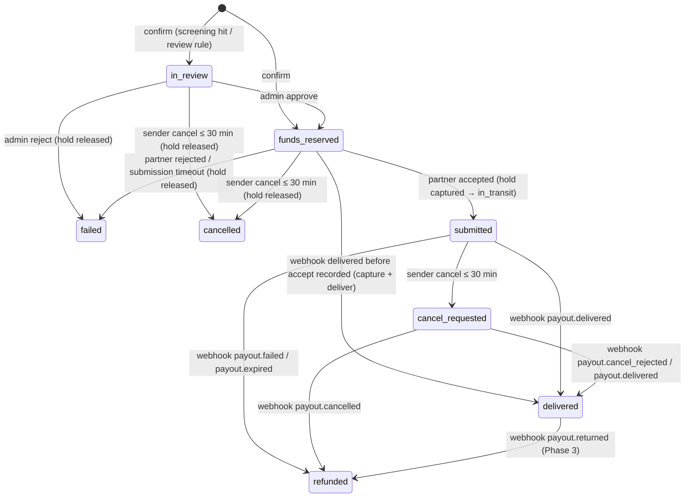

# FX Remittances (USD → MXN) · Requirements

Status: **parked** (see the [roadmap](../roadmap/index.md)) · Owner: product · Last updated: 2026-11-23
Depends on: [`00-ledger-foundation.md`](00-ledger-foundation.md) (shared Phase 0 with [`debit-card.md`](debit-card.md)): account naming, reversal entries, per-user receivable, `lockBalances`, `@Idempotent({ keyFrom })` and webhook signature guards are defined there, not here.

::: tip At a glance
Parked. Send USD from the wallet to Mexico, paid in MXN (SPEI or cash pickup) through a payout
partner: quote → confirm (hold) → partner webhooks → delivered/failed/cancelled/refunded. Ledger stays
USD-only; fee and FX spread are recognised on delivery. ≈ 1 XL + 2 L ([§13](#13-rollout)).
:::

## 1. Summary

- **Problem.** Senders hold a USD balance in the wallet but can't send it home. Today the only way out is a generic hold capture into `sys:payouts_out`, with no exchange rate, no recipient, no fee and no record of what the family received.
- **Solution.** The sender asks for a **quote** (USD sent, fee, rate, MXN received, expiry). They **confirm** it, which reserves the USD with the existing **hold** primitive. A **payout partner** delivers MXN by **SPEI** (bank deposit to a CLABE) or **cash pickup**. Partner webhooks move the remittance to `delivered`, `failed`, `cancelled` or `refunded`.
- **Ledger.** It stays **USD-only** in the MVP. MXN amounts and rates are stored on the quote as integer minor units and scaled integers. Revenue (fee + FX spread) is recognised in two new revenue accounts on delivery. Every movement is a balanced `LedgerService.postTransaction` call.
- **Why.** Remittances are the core product (US→MX family remittances were USD 30.76B in 1H26 [S10]). The fee plus the FX spread is the main revenue line, and the current backend earns nothing.
- **MVP size.** Three phases, roughly one XL and two L on the project's [effort scale](../roadmap/estimation.md) (§13). It reuses holds, idempotency, the ledger and reconciliation. New pieces: quotes, recipients, remittances, a partner client and a webhook endpoint.

## 2. Users and jobs to be done

| User | Job to be done |
|---|---|
| **Sender** (US resident, often Spanish-speaking, mobile-first) | "Send $200 to my mother in Puebla and know exactly how many pesos she gets, what it costs, and when she has it." |
| **Recipient** (MX, bank account or unbanked) | "Get the pesos into my bank account (CLABE), or pick up cash near me with a reference code." |
| **Compliance analyst** | "Review flagged transfers (sanctions hits, unusual patterns) before money leaves, and approve or reject them with a reason." |
| **Finance / treasury** | "Know daily what we owe the partner, what we earned (fee vs FX), and prove that our ledger matches the partner's statement." |
| **Support agent** | "See a remittance's status, cancel within the legal window, and trigger refunds without touching the database." |

## 3. Business case

### Revenue model
- **Transfer fee**: flat per transfer. *Assumption:* SPEI $2.99 (299), cash pickup $3.99 (399).
- **FX spread**: the customer rate is the partner rate minus `spread_bps`. *Assumption:* 100–150 bps.
- Both are recognised **on delivery**, not on confirm, so cancellations and failures never need revenue reversals (finance must sign off on this policy).

### Unit economics for an average transfer (all inputs are assumptions to validate)

| Line | Per transfer | Notes |
|---|--:|---|
| Average principal | $350.00 | Assumption: typical family remittance ticket |
| Fee revenue | +$2.99 | SPEI |
| FX revenue (100 bps) | +$3.50 | |
| **Gross revenue** | **+$6.49** | Take rate ≈ 1.85% |
| Partner payout fee | −$1.00 | Assumption: per-payout fee; cash is likely higher |
| ACH funding cost | −$2.80 | Assumption: 0.8% capped at $5 per pull, one deposit per transfer. Verify the negotiated rate |
| KYC / screening (amortised) | −$0.10 | Assumption |
| Fraud and ACH-return losses (20 bps) | −$0.70 | Target ceiling |
| Support / ops | −$0.30 | Assumption |
| **Contribution margin** | **≈ +$1.59** | |

Takeaway: **funding cost, not FX, decides profitability.** Cheaper funding (debit card push, RTP, or users leaving a balance in the wallet) is the biggest lever after launch. It is out of scope here but should be on the roadmap.

### Key metrics (targets are hypotheses for the beta)

| Metric | Target | Why |
|---|---|---|
| Quote → confirm conversion | ≥ 55% | Price competitiveness signal |
| SPEI delivered within 30 min of confirm (p95) | ≥ 95% | SPEI runs 24/7 and settles in seconds [S4]; the delay is ours or the partner's |
| Failure rate (failed + refunded / confirmed) | ≤ 2% | Bad CLABEs, partner errors |
| Refund credited to wallet after the failure event | ≤ 1 min (legal max 3 business days for cancellations [S1]) | Refund is a ledger entry, not a bank movement |
| Unresolved reconciliation breaks older than 1 business day | 0 | Partner trust, audit |
| Fraud + ACH-return loss | ≤ 20 bps of principal | Main loss driver (see §11) |
| Revenue per delivered transfer | ≥ $6.00 | Covers variable cost |

## 4. Scope

### In scope (MVP)
- USD → MXN only, one payout partner, two payout methods: `spei`, `cash_pickup`.
- Sender profile with the minimum fields Reg E receipts and screening need, plus a `kyc_status` gate (set by an admin endpoint that simulates the KYC vendor).
- Recipients (CRUD-lite: create, list, get, disable). CLABE validation.
- FX rate feed (admin endpoint in Phase 1, partner rate API in Phase 2), quotes with a locked rate and expiry, fee schedule.
- Confirm → hold → submit to partner → webhook → delivered / failed / cancelled / refunded.
- Sender cancellation within 30 minutes (Reg E) [S1].
- Per-transfer, daily and 30-day limits, and basic velocity rules.
- Sanctions screening hook (sender + recipient) with a manual review queue.
- New system accounts for in-transit funds, partner payable, fee revenue, FX revenue and payout fee expense.
- Partner prefunding entries and a daily partner reconciliation report.

### Out of scope (non-goals)
- Holding MXN balances for users, or multi-currency user wallets.
- Corridors other than US→MX. Receive-amount-driven quotes ("she must get exactly MXN 5,000").
- Scheduled and recurring transfers (they fall under different Reg E timing rules, §1005.36 [S1]).
- Cash-funded transfers (this avoids the 1% excise tax collection flow, §11). Debit card funding.
- Authentication and authorisation (the existing project has none; flagged in Open questions).
- Real KYC vendor integration, real OFAC vendor integration, SAR filing tooling.
- Fixing "ACH returned after settlement" in the deposit flow. It is a **prerequisite risk**, not a deliverable (§11).

### Deferred (later phases)
- **Phase 4**: multi-currency ledger with MXN treasury accounts, used if we prefund the partner in MXN or buy MXN from a liquidity provider (§6.6).
- Promotions and first-transfer-free pricing, more corridors (GT, HN, SV, DO), delivery to debit cards and wallets in MX.
- Encrypting PII (CLABE, DOB) at rest at the column level.

## 5. User stories with acceptance criteria

Amounts in examples use the worked example in §6.3: send 20,000 ¢, fee 299 ¢, partner rate 18.000000, spread 150 bps.

### US-1 · Add a recipient
- **Given** wallet `juan` exists **when** `POST /wallets/juan/recipients` with `{first_name:"María", last_name:"López", second_last_name:"Ruiz", payout_method:"spei", clabe:"<18 valid digits>"}` **then** 201 with `status:"active"`, `clabe_last4`, `bank_code` (first 3 digits), and the full CLABE is never returned.
- **Given** a CLABE with 17 digits, letters, or a wrong check digit **then** 400 `invalid_request` and no row is created.
- **Given** `payout_method:"cash_pickup"` **then** `clabe` must be absent (400 if present). First and last name are required because they must match the recipient's ID at pickup.
- **Given** the recipient's name is a potential sanctions match **then** 201 with `screening_status:"potential_match"`. Quotes for that recipient are allowed, but a confirmed remittance goes to `in_review`.

### US-2 · Get a quote
- **Given** `juan` has `kyc_status:"verified"`, an active recipient and a valid rate **when** `POST /wallets/juan/quotes {recipient_id, send_amount_cents:20000}` **then** 201 with `fee_cents:299`, `tax_cents:0`, `total_cents:20299`, `exchange_rate:"17.7300"`, `receive_amount_minor:354600`, `receive_currency:"MXN"`, `estimated_available_at`, `expires_at = now + 10 min`.
- **Given** no rate newer than its `valid_until` **then** 503 `fx_rate_unavailable` (not stored under the idempotency key, so the client can retry).
- **Given** `send_amount_cents` < 1,000 or > 299,999 **then** 400 `invalid_request`.
- **Given** the sender is not KYC-verified **then** 403 `kyc_required`.
- **Given** the recipient is disabled or belongs to another owner **then** 409 `recipient_not_active` / 404 `not_found`.
- A quote does **not** check balance or limits. Those are checked at confirm, so the sender can see prices before depositing.

### US-3 · Confirm (reserve the USD)
- **Given** an active, unexpired quote and `available_cents ≥ 20299` **when** `POST /remittances {quote_id}` **then** 201 with `status:"funds_reserved"` (or `in_review`), `available_cents` drops by 20,299, `held_cents` rises by 20,299, the quote becomes `consumed`, and `cancel_until = confirmed_at + 30 min`.
- **Given** `available_cents < 20299` (including money only in `pending`) **then** 422 `insufficient_funds`. No remittance or hold row is left, and the **quote stays active** so the sender can retry before it expires.
- **Given** `expires_at ≤ now()` **then** 409 `quote_expired`.
- **Given** the quote was already confirmed (a different Idempotency-Key) **then** 409 `quote_already_used`. The same key replays the original 201.
- **Given** the transfer would exceed a limit **then** 422 `limit_exceeded` with `details:{limit:"daily", limit_cents, used_cents, requested_cents}`.
- **Given** two confirms for different quotes from the same sender run in parallel and together exceed the daily limit **then** exactly one succeeds.

### US-4 · Delivery (happy path)
- **Given** a `funds_reserved` remittance **when** the partner accepts the payout **then** status `submitted`, the hold is `captured` into `sys:remittances_in_transit`, and `held_cents` drops by 20,299.
- **Given** `submitted` **when** the webhook `payout.delivered` arrives **then** status `delivered` and the delivered journal (§6.3, op 4) is posted once.
- **Given** the same webhook again (same event id, or a new event id with the same type) **then** 200, no new entries.
- For cash pickup, the `submitted` response includes `pickup_code` from the partner.

### US-5 · Failure and refund
- **Given** `funds_reserved` **when** the partner rejects the payout synchronously (e.g. invalid account) **then** status `failed`, the hold is `released`, and `available_cents` is restored in full (fee included).
- **Given** `submitted` **when** the webhook `payout.failed` or `payout.expired` (cash not picked up) arrives **then** status `refunded`, and 20,299 is credited to `user:available` with key `remittance:<id>:refunded`.
- **Given** `funds_reserved` for longer than the submission deadline (hold `expires_at − 5 min`) without a partner acceptance **then** the sweeper moves it to `failed` with `failure_code:"submission_timeout"` and releases the hold.
- **Given** `delivered` **when** `payout.returned` arrives (the beneficiary bank returned the SPEI) **then** status `refunded` and the return journal (§6.3, op 6) is posted. *Phase 3.*

### US-6 · Sender cancellation (Reg E 30-minute right) [S1]
- **Given** `funds_reserved` or `in_review` and `now ≤ cancel_until` **when** `POST /remittances/:id/cancel` **then** 200 `cancelled`, the hold is released, and the full total is back in `available`.
- **Given** `submitted` and `now ≤ cancel_until` **then** 200 `cancel_requested`, and the partner cancel API is called. `payout.cancelled` → `refunded`; `payout.cancel_rejected` or `payout.delivered` → `delivered`.
- **Given** `now > cancel_until` **then** 409 `cancellation_window_closed`.
- **Given** `delivered`, `failed` or `refunded` **then** 409 `remittance_not_cancellable`. Cancelling an already `cancelled` or `cancel_requested` remittance is a 200 no-op.

### US-7 · Compliance review
- **Given** a sanctions potential match or a review rule fires **when** the sender confirms **then** status `in_review`, the hold is active, and nothing is sent to the partner. **Review holds never auto-expire.**
- **Given** `in_review` **when** `POST /admin/remittances/:id/review {decision:"approve"}` **then** `funds_reserved`, and submission proceeds. With `{decision:"reject", reason}` → `failed`, hold released, `failure_code:"compliance_rejected"`.
- **Given** a *confirmed* sanctions match **then** the analyst must **not** reject-and-release. The funds may have to be blocked and reported (§11). MVP: leave it `in_review` and escalate offline.

### US-8 · Partner funding and reconciliation (finance)
- **Given** finance wires $5,000 to the partner **when** `POST /admin/partner-fundings {amount_cents:500000, reference}` **then** the funding journal (§6.3, op 7) is posted.
- **Given** the partner's daily statement **when** `GET /admin/reconciliation/partner?date=2026-11-09` **then** the response lists matched remittances, unmatched on our side, unmatched on the partner side, and amount mismatches (MXN amount, USD cost).

## 6. Money flows

### 6.1 Currency decision: USD-only ledger for the MVP (alternative to multi-currency accounts)

**Decision.** All ledger accounts stay USD. MXN appears only as data on the quote and remittance (`receive_amount_minor`, `customer_rate_e6`, `partner_rate_e6`). It never appears as ledger lines.

**Why this is enough for the MVP.**
1. Users never hold MXN. The only MXN in the system belongs to the partner, which delivers it.
2. *Assumption (partner):* the partner (a) gives us a **locked USD→MXN rate** valid for at least our quote TTL, and (b) settles with us **in USD** against a USD prefund. Our obligation to the partner is then a known USD amount (`partner_cost_cents`) at quote time, and our FX revenue is known at confirm.
3. `LedgerService.assertBalanced` checks that lines sum to 0 **across all lines**, and `reconcile()` checks `sum(entries) = 0` **globally**. Both are only correct within one currency. Adding MXN accounts would mean changing both, plus FX trading accounts, plus mark-to-market. That is a large change to the most critical code, and no MVP flow needs it.
4. The `accounts.currency` column already exists (default `'USD'`), so Phase 4 can introduce MXN accounts without a breaking migration.

**When this breaks.** If the partner only settles in MXN, or we buy MXN ourselves, we hold FX inventory and need Phase 4 (§6.6). That is a blocking open question for the partner (Q1).

### 6.2 New system accounts (migration `00N_remittances.sql`)

Names follow the convention in [`00-ledger-foundation.md` §3](00-ledger-foundation.md#3-account-naming-convention).

| Account id | normal_side | allow_negative | Meaning |
|---|---|---|---|
| `sys:remittances_in_transit` | credit | **false** | USD captured from senders for payouts accepted by the partner and not yet delivered or refunded. A liability. A negative balance would mean a double release, so the ledger rejects it. |
| `sys:partner_payable` | credit | true | What we owe the payout partner. **A negative balance means a prefund** (the partner holds our money). |
| `sys:revenue_transfer_fees` | credit | true | Transfer fees earned (on delivery). Negative only through post-delivery returns. |
| `sys:revenue_fx_spread` | credit | true | FX spread earned (on delivery). |
| `sys:expense_payout_fees` | debit | true | Partner's per-payout fee. |

Existing accounts reused: `user:<owner>:available`, `user:<owner>:held`, `sys:bank`. `sys:payouts_out` is **not** used by remittances. It stays for generic holds, so the two flows reconcile separately.

### 6.3 Journal entries (worked example, integer cents)

Quote: `send_amount_cents = 20000`, `fee_cents = 299`, `tax_cents = 0`, `total_cents = 20299`, `partner_rate_e6 = 18_000_000`, `customer_rate_e6 = 17_730_000`, `receive_amount_minor = 354600` (MXN 3,546.00), `partner_cost_cents = 19700`, `partner_fee_cents = 100`, `fx_revenue_cents = 300`.

| # | Operation | Debit (+) | Credit (−) | Amount | Journal key | Kind |
|---|---|---|---|--:|---|---|
| 1 | Confirm (hold created, existing primitive) | `user:juan:available` | `user:juan:held` | 20,299 | `hold:<hold_id>:created` | `hold_created` |
| 2 | Cancel / fail / reject before submission (hold released, existing) | `user:juan:held` | `user:juan:available` | 20,299 | `hold:<hold_id>:released` | `hold_released` |
| 3 | Partner accepted (hold captured, **new credit account**) | `user:juan:held` | `sys:remittances_in_transit` | 20,299 | `hold:<hold_id>:captured` | `hold_captured` |
| 4 | Delivered | `sys:remittances_in_transit` 20,299 · `sys:expense_payout_fees` 100 | `sys:partner_payable` 19,800 · `sys:revenue_fx_spread` 300 · `sys:revenue_transfer_fees` 299 | 20,399 = 20,399 | `remittance:<id>:delivered` | `remittance_delivered` |
| 5 | Refund after submission (failed / expired / cancelled by partner) | `sys:remittances_in_transit` | `user:juan:available` | 20,299 | `remittance:<id>:refunded` | `remittance_refunded` |
| 6 | Returned after delivery (Phase 3; *assumption:* partner returns principal cost but keeps its 100 fee) | `sys:partner_payable` 19,700 · `sys:revenue_fx_spread` 300 · `sys:revenue_transfer_fees` 299 | `user:juan:available` 20,299 | 20,299 = 20,299 | `remittance:<id>:returned` | `remittance_returned` |
| 7 | Prefund the partner (wire out of our bank) | `sys:partner_payable` | `sys:bank` | 500,000 | `partner_funding:<funding_id>` | `partner_funding` |
| 8 | Statement adjustment (Phase 3, e.g. partner charged 1 ¢ more than our quote) | `sys:revenue_fx_spread` | `sys:partner_payable` | 1 | `partner_adjustment:<statement_id>:<line_no>` | `partner_adjustment` |

In `postTransaction` terms, debit lines are positive `amountCents` and credit lines negative. Op 4 as `Line[]`:
`[{in_transit,+20299},{payout_fee_expense,+100},{partner_payable,-19800},{fx_revenue,-300},{fee_revenue,-299}]`, which sums to 0.

**Balances after confirm → submit → deliver** (natural balances, cents):

| Step | juan:available | juan:held | in_transit | partner_payable | fee_rev | fx_rev | fee_exp |
|---|--:|--:|--:|--:|--:|--:|--:|
| Start (after a settled $250 deposit) | 25,000 | 0 | 0 | −500,000 (prefunded) | 0 | 0 | 0 |
| 1 · Confirm | **4,701** | **20,299** | 0 | −500,000 | 0 | 0 | 0 |
| 3 · Accepted | 4,701 | **0** | **20,299** | −500,000 | 0 | 0 | 0 |
| 4 · Delivered | 4,701 | 0 | **0** | **−480,200** | **299** | **300** | **100** |

The partner's prefund falls by exactly what it paid out (19,700 cost + 100 fee). We earned 599 gross, 499 net of the payout fee.

**Webhook arrives before our capture was recorded** (crash between partner accept and our commit): in one DB transaction, post op 3 and then op 4 (two journal transactions, each with its own key). See §10.

### 6.4 Pricing math (integers only, BigInt for intermediates)

Rates are integers scaled by 10^6 (`_e6`). USD cents and MXN centavos both have 2 decimals, so the scale cancels out.

```
customer_rate_e6     = floor(partner_rate_e6 * (10_000 - spread_bps) / 10_000 / 100) * 100   // floor to 4 decimals (disclosed rate)
receive_amount_minor = floor(send_amount_cents * customer_rate_e6 / 1_000_000)                // recipient never gets a fraction
partner_cost_cents   = ceil(receive_amount_minor * 1_000_000 / partner_rate_e6)               // conservative: assume we owe more
fx_revenue_cents     = send_amount_cents - partner_cost_cents                                 // must be ≥ 0, else 503 fx_rate_unavailable + alert
total_cents          = send_amount_cents + fee_cents + tax_cents
```

- The disclosed rate is rounded to 4 decimals, and the MXN amount is computed **from the disclosed rate**, so what we show is exactly what is delivered. Reg E requires the rate to be rounded consistently to 2–4 decimals [S2].
- Rounding example: send 12,345 ¢ at 17.7300 → receive `floor(218,876.85) = 218,876` centavos. Partner cost `ceil(218,876 / 18) = ceil(12,159.78) = 12,160` ¢. FX revenue 185 ¢.
- **Overflow:** 299,999 × 20,000,000 ≈ 6×10^12 is safe. But `MAX_AMOUNT_CENTS` (10^9) × 2×10^7 = 2×10^16 exceeds `Number.MAX_SAFE_INTEGER` (≈9×10^15). Do the math in `BigInt` and convert back with a `Number.isSafeInteger` check, matching the existing `pg` parser rule.
- If the partner's actual USD charge differs from `partner_cost_cents`, the ledger records the quote value. The daily statement diff is posted as op 8.

### 6.5 What reconciles to what (ledger-level)
- `balance(sys:remittances_in_transit) = Σ total_cents of remittances in {submitted, cancel_requested}`.
- `Σ balance(user:*:held) = Σ active generic holds + Σ total_cents of remittances in {funds_reserved, in_review}`.
- `balance(sys:revenue_transfer_fees) = Σ fee_cents of delivered − Σ fee_cents of returned-after-delivery` (same for `sys:revenue_fx_spread`).
- The existing `GET /admin/reconciliation` (global sum = 0, cache = entries) keeps working unchanged because everything is USD.

### 6.6 Phase 4 sketch (deferred): multi-currency treasury
Only if Q1 says the partner settles in MXN. Then: (1) `assertBalanced` checks the sum per currency, using `accounts.currency` from the lock query; (2) `reconcile()` groups by currency; (3) add trading accounts `sys:fx_position:USD` / `sys:fx_position:MXN`, with every conversion posting one balanced pair per currency; (4) add MXN prefund `sys:partner_prefund:MXN` and periodic revaluation. This is not in the MVP.

## 7. State machines

All transitions lock the row with `SELECT … FOR UPDATE` (same pattern as `HoldsService.transition`). Repeating the transition to the current state is a no-op that returns the object (200).

### 7.1 Quote

| From | Event | To | Notes |
|---|---|---|---|
| — | `POST /wallets/:owner/quotes` | `active` | `expires_at = now + QUOTE_TTL` (default 600 s, must be ≤ partner lock − 60 s) |
| `active` | confirm (and `now < expires_at`) | `consumed` | in the same tx as the remittance insert |
| `active` | confirm and `now ≥ expires_at` | (unchanged) | 409 `quote_expired`. "Expired" is derived from time, not stored |
| `consumed` | confirm | — | 409 `quote_already_used` (DB backstop: `remittances.quote_id UNIQUE`) |
| `active` | confirm fails (`insufficient_funds`, `limit_exceeded`) | `active` | savepoint rollback keeps it active |

### 7.2 Remittance



| Current | Request | Result | HTTP |
|---|---|---|---|
| any non-terminal | same event again (duplicate webhook) | no-op | 200 |
| `cancelled`, `cancel_requested` | cancel | no-op | 200 |
| `delivered`, `failed`, `refunded` | cancel | error `remittance_not_cancellable` | 409 |
| cancellable, `now > cancel_until` | cancel | error `cancellation_window_closed` | 409 |
| `submitted` | admin submit | no-op | 200 |
| not `funds_reserved` / `submitted` | admin submit | error `invalid_remittance_transition` | 409 |
| not `in_review` | admin review | error `invalid_remittance_transition` | 409 |
| `delivered` | webhook `payout.failed` | **ignored**, recorded with `outcome:"conflict"`, alert | **200** (a 4xx would make the partner retry forever) |
| `failed`, `cancelled` | webhook `payout.delivered` | **ignored + P1 alert** (money may have left without a capture) | 200 |

Terminal states: `failed`, `cancelled`, `refunded`. `delivered` is terminal except for `payout.returned`.

### 7.3 Recipient
`active → disabled` via `POST /recipients/:id/disable` (repeat = no-op). There is no re-enable in the MVP; the sender creates a new recipient. `screening_status ∈ {clear, potential_match, blocked}` is independent of `status`. `blocked` → quotes return 409 `recipient_not_active`.

### 7.4 Hold (existing, extended)
States are unchanged (`active → captured | released`). New column `purpose ∈ {generic, remittance}`. Rules for `purpose = 'remittance'`:
- The generic endpoints `/holds/:id/capture|release` return **409 `hold_managed_by_remittance`**. Otherwise someone could capture it into `sys:payouts_out` and break the remittance's accounting.
- Capture by the remittance service **ignores `expires_at`**: if the partner already accepted, the money has left, and we must record it. Expiry is enforced earlier, by refusing to *submit* after `expires_at − 5 min`.
- TTL = 86,400 s (the existing `CreateHoldDto` max), which is the submission deadline. The sweeper skips holds of `in_review` remittances.

## 8. API changes

Every `POST` keeps `@Idempotent()`. Errors keep the `{ error: { code, message, details? } }` shape. Amounts are integer cents. MXN amounts are `*_minor` integers with an explicit `currency`.

### 8.1 Endpoints

| Method | Path | Body | Success | Errors |
|---|---|---|---|---|
| POST | `/wallets/:owner/sender-profile` | `{ full_name, address_line, city, state, postal_code, phone, date_of_birth }` | 201 profile (`kyc_status:"pending"`) | 404, 409 `sender_profile_exists` |
| POST | `/admin/senders/:owner/kyc` | `{ status: "verified"\|"rejected" }` | 200 | 404 |
| POST | `/wallets/:owner/recipients` | see US-1 | 201 recipient | 400, 404 |
| GET | `/wallets/:owner/recipients` | | `{ recipients[] }` | 404 |
| GET | `/recipients/:id` | | recipient | 404 |
| POST | `/recipients/:id/disable` | | 200 | 404 |
| POST | `/admin/fx-rates` | `{ pair:"USD_MXN", partner_rate_e6, spread_bps, ttl_seconds }` | 201 rate | 400 |
| POST | `/wallets/:owner/quotes` | `{ recipient_id, send_amount_cents }` | 201 quote | 400, 403 `kyc_required`, 404, 409 `recipient_not_active`, 503 `fx_rate_unavailable` |
| GET | `/quotes/:id` | | quote (+ `expired: bool`) | 404 |
| POST | `/remittances` | `{ quote_id }` | 201 remittance | 404, 409 `quote_expired` / `quote_already_used` / `recipient_not_active`, 422 `insufficient_funds` / `limit_exceeded`, 403 `kyc_required` |
| GET | `/remittances/:id` | | remittance | 404 |
| GET | `/wallets/:owner/remittances?limit=20&before=<created_at,id>` | | `{ remittances[], next_cursor }` | 404 |
| POST | `/remittances/:id/cancel` | | 200 | 409 `cancellation_window_closed` / `remittance_not_cancellable` |
| POST | `/admin/remittances/:id/submit` | | 200 (`submitted` or `failed`) | 409 `invalid_remittance_transition`, 502 `partner_unavailable` (not stored, retryable) |
| POST | `/admin/remittances/:id/review` | `{ decision:"approve"\|"reject", reason }` | 200 | 409 `invalid_remittance_transition` |
| POST | `/webhooks/payout-partner` | partner event (§8.3) | 200 `{ received: true }` | 401 `invalid_signature`, 400 |
| POST | `/admin/partner-fundings` | `{ amount_cents, reference }` | 201 | 400 |
| GET | `/admin/reconciliation/partner?date=YYYY-MM-DD` | | report (§12) | 400 |

### 8.2 Shapes

**Quote (201)**, which contains every Reg E prepayment disclosure field [S2]:
```json
{
  "id": "6d1c…", "owner": "juan", "recipient_id": "a3f…", "payout_method": "spei",
  "send_amount_cents": 20000, "fee_cents": 299, "tax_cents": 0, "total_cents": 20299,
  "send_currency": "USD",
  "exchange_rate": "17.7300", "exchange_rate_e6": 17730000,
  "receive_amount_minor": 354600, "receive_currency": "MXN",
  "other_fees_minor": 0,
  "estimated_available_at": "2026-11-11T18:00:00Z",
  "expires_at": "2026-11-10T18:10:00Z", "status": "active", "created_at": "…"
}
```
Internal fields (`partner_rate_e6`, `partner_cost_cents`, `fx_revenue_cents`, `partner_fee_cents`) are stored but **never returned** to the sender.

**Remittance (201/200)**, which adds the receipt fields [S2]:
```json
{
  "id": "…", "owner": "juan", "quote_id": "…", "status": "funds_reserved",
  "recipient": { "name": "María López Ruiz", "payout_method": "spei", "clabe_last4": "1234", "bank_code": "012" },
  "send_amount_cents": 20000, "fee_cents": 299, "tax_cents": 0, "total_cents": 20299,
  "exchange_rate": "17.7300", "receive_amount_minor": 354600, "receive_currency": "MXN",
  "estimated_available_at": "…", "may_be_available_sooner": true,
  "confirmed_at": "…", "cancel_until": "…",
  "pickup_code": null, "failure_code": null, "failure_reason": null,
  "created_at": "…", "updated_at": "…"
}
```
Static receipt content (provider name and phone, CFPB and state regulator contacts, error-resolution and cancellation text in English **and Spanish** [S2]) is the client's job, from templates approved by compliance. The API returns the data.

### 8.3 Payout partner webhook (our expected contract; *assumption* until we have partner docs)
Headers: `X-Partner-Event-Id` (unique), `X-Partner-Signature` (HMAC-SHA256 of the raw body with a shared secret).
```json
{ "event_id": "evt_…", "type": "payout.delivered", "payout_id": "po_…",
  "reference": "<remittance id>", "occurred_at": "…",
  "amount": { "currency": "MXN", "minor": 354600 }, "failure_code": null }
```
Types: `payout.delivered`, `payout.failed`, `payout.expired`, `payout.cancelled`, `payout.cancel_rejected`, `payout.returned`.

### 8.4 Idempotency behaviour
- Client POSTs: unchanged. The `IdempotencyInterceptor` stores 2xx and `DomainError` < 500. `fx_rate_unavailable` (503) and `partner_unavailable` (502) are **not** stored, so the client retries with the same key.
- **Webhook:** `@Idempotent({ keyFrom: (req) => req.header('x-partner-event-id') })`, the shared option defined in [`00-ledger-foundation.md` §7](00-ledger-foundation.md#7-webhook-idempotency-idempotent-keyfrom-). This keeps the project rule "all POSTs use `@Idempotent()`" without requiring the partner to send our header.
- **Signature verification must run before the interceptor claims the key.** It goes in `PayoutPartnerSignatureGuard`, a Nest **Guard** built on the shared helper in [`00-ledger-foundation.md` §8](00-ledger-foundation.md#8-webhook-signature-guards) (guards run before interceptors). Otherwise a forged request carrying a real event id would store a 401 under that id, and the legitimate delivery would replay the 401. The `rawBody: true` setup (app and tests) is part of the foundation.
- Second safety net: every state change posts journals with deterministic keys (`remittance:<id>:delivered`, …), so `postTransaction` returns `replayed: true` on a duplicate.
- Partner calls: `create payout` is sent with `reference = remittance.id`. *Assumption:* the partner deduplicates on `reference`, which makes our retries safe.

### 8.5 New `ERROR_STATUS` codes (`src/common/domain.error.ts`)
`kyc_required` 403 · `invalid_signature` 401 · `recipient_not_active` 409 · `quote_expired` 409 · `quote_already_used` 409 · `remittance_not_cancellable` 409 · `cancellation_window_closed` 409 · `invalid_remittance_transition` 409 · `hold_managed_by_remittance` 409 · `sender_profile_exists` 409 · `limit_exceeded` 422 · `partner_unavailable` 502 · `fx_rate_unavailable` 503.

## 9. Data model changes

New file **`migrations/00N_remittances.sql`**, the next free number after the shared `002_ledger_foundation.sql` (applied migrations are never edited). Plain SQL, no ORM.

```sql
-- System accounts
insert into accounts (id, kind, normal_side, allow_negative) values
  ('sys:remittances_in_transit', 'system', 'credit', false),
  ('sys:partner_payable',        'system', 'credit', true),
  ('sys:revenue_transfer_fees',            'system', 'credit', true),
  ('sys:revenue_fx_spread',             'system', 'credit', true),
  ('sys:expense_payout_fees',     'system', 'debit',  true);
insert into balances (account_id)
  select id from accounts where id in ('sys:remittances_in_transit','sys:partner_payable',
    'sys:revenue_transfer_fees','sys:revenue_fx_spread','sys:expense_payout_fees');

-- Holds owned by a remittance can't be driven through the generic endpoints
alter table holds add column purpose text not null default 'generic'
  check (purpose in ('generic','remittance'));

create table sender_profiles (
  owner_id      text primary key,
  full_name     text not null,
  address_line  text not null, city text not null, state char(2) not null, postal_code text not null,
  phone         text not null,
  date_of_birth date not null,
  kyc_status    text not null default 'pending' check (kyc_status in ('pending','verified','rejected')),
  created_at    timestamptz not null default now(),
  updated_at    timestamptz not null default now()
);

create table recipients (
  id               uuid primary key default gen_random_uuid(),
  owner_id         text not null,
  first_name       text not null,
  last_name        text not null,
  second_last_name text,
  country          char(2) not null default 'MX' check (country = 'MX'),
  phone            text,
  payout_method    text not null check (payout_method in ('spei','cash_pickup')),
  clabe            char(18) check (clabe ~ '^[0-9]{18}$'),
  status           text not null default 'active' check (status in ('active','disabled')),
  screening_status text not null default 'clear' check (screening_status in ('clear','potential_match','blocked')),
  created_at       timestamptz not null default now(),
  updated_at       timestamptz not null default now(),
  check ((payout_method = 'spei') = (clabe is not null))
);
create index recipients_owner_idx on recipients (owner_id);

create table fx_rates (
  id              bigserial primary key,
  pair            text not null check (pair = 'USD_MXN'),
  partner_rate_e6 bigint not null check (partner_rate_e6 > 0),
  spread_bps      int not null check (spread_bps between 0 and 1000),
  valid_until     timestamptz not null,
  created_at      timestamptz not null default now()
);
create index fx_rates_latest_idx on fx_rates (pair, created_at desc);

create table quotes (
  id                     uuid primary key default gen_random_uuid(),
  owner_id               text not null,
  recipient_id           uuid not null references recipients(id),
  payout_method          text not null,
  fx_rate_id             bigint not null references fx_rates(id),
  send_amount_cents      bigint not null check (send_amount_cents > 0),
  fee_cents              bigint not null check (fee_cents >= 0),
  tax_cents              bigint not null default 0 check (tax_cents >= 0),
  total_cents            bigint not null,
  partner_rate_e6        bigint not null,
  customer_rate_e6       bigint not null,
  receive_amount_minor   bigint not null check (receive_amount_minor > 0),
  receive_currency       char(3) not null default 'MXN',
  partner_cost_cents     bigint not null,
  partner_fee_cents      bigint not null check (partner_fee_cents >= 0),
  fx_revenue_cents       bigint not null check (fx_revenue_cents >= 0),
  estimated_available_at timestamptz not null,
  expires_at             timestamptz not null,
  status                 text not null default 'active' check (status in ('active','consumed')),
  consumed_at            timestamptz,
  created_at             timestamptz not null default now(),
  check (total_cents = send_amount_cents + fee_cents + tax_cents),
  check (fx_revenue_cents = send_amount_cents - partner_cost_cents)
);
create index quotes_owner_idx on quotes (owner_id, created_at desc);

create table remittances (
  id                 uuid primary key default gen_random_uuid(),
  owner_id           text not null,
  quote_id           uuid not null unique references quotes(id),
  hold_id            uuid not null unique references holds(id),
  recipient_id       uuid not null references recipients(id),
  recipient_snapshot jsonb not null,           -- name/CLABE as confirmed; later edits don't affect it
  status             text not null check (status in ('in_review','funds_reserved','submitted',
                       'cancel_requested','delivered','failed','cancelled','refunded')),
  partner_payout_id  text unique,
  pickup_code        text,
  failure_code       text,
  failure_reason     text,
  submit_attempts    int not null default 0,
  next_submit_at     timestamptz,
  confirmed_at       timestamptz not null default now(),
  cancel_until       timestamptz not null,      -- confirmed_at + 30 min
  submitted_at       timestamptz,
  delivered_at       timestamptz,
  finished_at        timestamptz,
  created_at         timestamptz not null default now(),
  updated_at         timestamptz not null default now()
);
create index remittances_owner_idx on remittances (owner_id, created_at desc, id desc);
create index remittances_work_idx on remittances (status, next_submit_at)
  where status in ('funds_reserved','submitted','cancel_requested');

create table partner_events (           -- audit + out-of-order handling; dedupe is the interceptor's job
  event_id      text primary key,
  remittance_id uuid references remittances(id),
  type          text not null,
  payload       jsonb not null,
  outcome       text not null check (outcome in ('applied','noop','conflict','unknown_reference')),
  received_at   timestamptz not null default now()
);

create table partner_fundings (
  id           uuid primary key default gen_random_uuid(),
  amount_cents bigint not null check (amount_cents > 0),
  reference    text not null unique,
  created_at   timestamptz not null default now()
);
```

Money lives only in the ledger. `quotes` and `remittances` hold **process state and pricing snapshots**; the `quotes` money columns are never updated after insert. Existing data needs no migration (`holds.purpose` defaults to `generic`).

### Code touch points (for the engineer)
- `src/wallet/accounts.ts`: add the 5 `SYS` ids.
- `src/wallet/holds.service.ts`: `create(owner, amount, ttl, purpose = 'generic')`. Add an internal `captureTo(id, creditAccount, { ignoreExpiry })` and `releaseInternal(id)` for the remittance service. The public `capture` and `release` reject `purpose='remittance'`.
- `src/idempotency/*`: nothing feature-specific; uses the shared `keyFrom` option (foundation).
- New `src/remittances/` module: `recipients.*`, `quotes.*`, `remittances.*` (service + controller), `pricing.ts` (pure BigInt functions, unit-tested), `payout-partner.client.ts` (interface + `FakePayoutPartner` for tests and Phase 1), `partner-webhook.guard.ts`, `limits.ts`, `submission.worker.ts` (Phase 2, `setInterval` in `onModuleInit`, disabled when `NODE_ENV=test`). No new dependencies: use `fetch` and `node:crypto`.
- `src/common/domain.error.ts`: new codes (§8.5).

## 10. Edge cases and failure modes

| # | Situation | Expected behaviour |
|---|---|---|
| E1 | Client retries confirm with the same Idempotency-Key | Interceptor replays the 201. One hold, one remittance. |
| E2 | Same quote confirmed twice with **different** keys (double tap) | Quote row `FOR UPDATE`. The second request sees `consumed` → 409 `quote_already_used`. Backstop: `remittances.quote_id UNIQUE`. |
| E3 | Quote expires during the confirm request | Expiry is checked under the row lock with the DB's `now()`. Expired → 409, nothing reserved. |
| E4 | Insufficient funds at confirm | `postTransaction` throws 422. The savepoint rolls back the remittance row, hold row and quote status. The quote stays active. |
| E5 | Two confirms from one sender in parallel near the daily limit | Confirm first locks `balances` for `user:<owner>:available` `FOR UPDATE`, then sums limits, then creates the hold. The same tx re-locks it in `postTransaction`, which is safe and keeps lock order (`available` < `held` alphabetically). Exactly one passes. |
| E6 | Partner `create payout` times out | Remittance stays `funds_reserved`, `submit_attempts++`, `next_submit_at` backs off (30 s, 2 m, 10 m …). The retry uses the same `reference`. The partner dedupes (*assumption*), so no double payout. |
| E7 | Partner accepted, our process crashed before commit | The next attempt gets "already exists" with the original `payout_id`, and we capture then. Or the webhook arrives first: the `funds_reserved → delivered` path posts op 3 and op 4 in one tx. |
| E8 | Hold reaches its submission deadline without partner acceptance | Sweeper: `failed`/`submission_timeout`, hold released (op 2). It **first queries the partner by reference**; if the partner has the payout, it captures instead. |
| E9 | Duplicate webhook (same event id) | Interceptor replays the stored 200. No second processing. |
| E10 | Same event type, new event id | State no-op (`delivered` → `delivered`). The journal key would replay anyway. Recorded `outcome:"noop"`. |
| E11 | Out-of-order webhooks (`failed` after `delivered`) | Ignored, `outcome:"conflict"`, 200, P1 alert for manual review. A real reversal comes only as `payout.returned`. |
| E12 | Webhook for an unknown `reference` | 200, `outcome:"unknown_reference"`, alert. A 4xx would make the partner retry forever. |
| E13 | Forged webhook / bad signature | Guard → 401 before the idempotency key is claimed. Nothing stored. Alert if the rate is above 10/hour. |
| E14 | Cancel races with `payout.delivered` | Both lock the remittance row. Whichever commits first wins. Cancel after delivered → 409 `remittance_not_cancellable`. Delivered after `cancel_requested` → `delivered`. |
| E15 | Partner confirms cancel after 3 business days | We already owe the refund within 3 business days of the request [S1]. *Policy (assumption, compliance to confirm):* if the partner hasn't confirmed by day 2, ops escalates. Because the refund is a ledger credit, it is instant once confirmed. |
| E16 | Cash not picked up | Partner sends `payout.expired` (*assumption:* ~30 days) → `refunded` in full. |
| E17 | SPEI returned after `delivered` (closed account) | `payout.returned` → op 6 → `refunded`. Phase 3. Until then: alert and manual handling. |
| E18 | Recipient edited or disabled after the quote | Confirm checks `status='active'` and `screening_status <> 'blocked'`. The remittance stores `recipient_snapshot`, so in-flight transfers use the confirmed details. |
| E19 | Rate feed stale | No `fx_rates` row with `valid_until > now()` → 503 on quote. Existing quotes stay valid until their own `expires_at` (partner lock assumption). |
| E20 | Computed `fx_revenue_cents < 0` (misconfigured rate) | Quote refused (503) + alert. The DB check constraint is the backstop. |
| E21 | Rounding | Floor for the recipient's MXN, ceil for our partner cost (§6.4). Never floats. BigInt for intermediates. |
| E22 | Partner charges a different USD amount than `partner_cost_cents` | Ledger keeps the quote values. The daily statement diff is posted as op 8 and alerted if > 100 ¢ per day. |
| E23 | `in_review` for longer than 24 h | The hold doesn't expire (sweeper skips it). Alert at a 4 h SLA. The sender sees `in_review`. |
| E24 | Partner prefund exhausted | The partner rejects with "insufficient balance" → **not** a definitive failure. Keep `funds_reserved`, retry, page treasury. The balance alert (§12) should fire first. |
| E25 | Generic hold endpoints called on a remittance hold | 409 `hold_managed_by_remittance`. |
| E26 | Sender's ACH deposit is returned **after** settlement, after the MXN is delivered | Not handled by today's deposit flow (README: out of scope). The loss falls on us. See §11 (top risk). |

## 11. Compliance, risk and fraud

> Nothing here is legal advice. Every item needs sign-off from the compliance officer and outside counsel before launch.

| Area | What applies | Who | MVP control | Status |
|---|---|---|---|---|
| **Reg E Subpart B (Remittance Rule)** | Applies to providers above the 500-transfers-per-year normal-course-of-business safe harbor [S3]; we will exceed it. Prepayment disclosure (amount, fees, taxes, total, rate rounded to 2–4 decimals, amount received, third-party fees) and receipt (date available, recipient, cancellation and error-resolution rights, provider contacts, regulator contacts) [S2]. Disclosures in English **and the language used to transact** (Spanish) [S2]. | Us | Quote/remittance responses carry every field (§8.2). Compliance-approved EN/ES templates in the client. | Verified [S2][S3] |
| **Cancellation** | Honour cancellation requests received ≤ 30 min after payment if funds not yet picked up or deposited; refund **including fees** within 3 business days [S1]. | Us (partner must support cancel) | `cancel_until`, US-6. Refund = instant ledger credit. | Verified [S1] |
| **Error resolution** | Sender has 180 days after the disclosed availability date to report. We investigate within 90 days and report within 3 business days of finishing. Late delivery is an error unless an exception applies (fraud/sanctions/BSA screening, extraordinary circumstances, wrong account number from the sender). Remedies include refunding fees. [S5] | Us | Out of MVP code: support process + a manual refund tool (Phase 3). Conservative `estimated_available_at` (+1 day with "may be available sooner") to reduce late-delivery errors. | Verified [S5] |
| **Remittance excise tax (IRC §4475)** | 1% on transfers after 2025-12-31, **only when funded with cash, money order, cashier's check or similar physical instrument**. The provider collects it and is secondarily liable. Semi-monthly deposits, Form 720 quarterly. Regulations are **proposed** (Apr 2026). [S6][S7] | Us (collect), sender (pays) | Wallet is funded by ACH from a bank account, so **assumed not taxable**. `tax_cents` is present and 0 so the disclosure line exists. Cash-in funding is a non-goal. | **Assumption**: tax counsel must confirm that a stored-value wallet funded by ACH is outside scope (Q4) |
| **Licensing / registration** | FinCEN MSB registration and state money transmitter licences (or operating as agent of a licensed partner/sponsor). | Us / legal | Not code. Feature flag per state (`REMITTANCES_STATES`) so we can switch states off. | **Assumption**: licensing status unknown (Q5) |
| **KYC / CIP** | Verified sender identity before sending. | Us (vendor) | `sender_profiles.kyc_status = 'verified'` required for quote and confirm (403). | Control defined; vendor TBD |
| **OFAC sanctions** | Screen sender and recipient against SDN and other lists. A true match may require **blocking** the funds and reporting, not returning them. | Us (vendor); partner screens too | Screen at recipient creation and at every confirm. Hit → `in_review`, no submission, no auto-expiry. True-match handling is a manual compliance procedure in the MVP (a `blocked` ledger account is deferred). | **Assumption** on exact blocking/reporting timelines; compliance to define |
| **SAR** | MSBs file SARs for suspicious transactions ≥ $2,000, within 30 days of detection [S8]. | Us | Monitoring rules flag to the review queue (structuring just under limits, many senders → one recipient, rapid deposit-then-send). Filing is outside the system. | Threshold verified [S8] |
| **Recordkeeping / travel rule** | Funds transfers ≥ $3,000: collect, keep (5 years) and pass on originator/beneficiary info [S9]. | Us + partner | Per-transfer max $2,999.99 keeps every MVP transfer below it. Still keep all remittance records ≥ 5 years (append-only ledger + no deletes on remittances). | Verified [S9]; a 2020 proposal to lower it to $250 for cross-border transfers is unconfirmed [S9] |
| **Cash CTR / SW border GTO** | GTO CTR obligations apply to **cash** transactions at MSBs in listed ZIP codes [S11]. | — | Not applicable while funding is ACH-only. Re-check if cash-in is added. | Verified scope; current renewal status unverified |
| **State immigration-status bills** | Several states (e.g. Missouri, Michigan) have proposed requiring status verification for remittance senders [S12]. | Legal | Monitor. State-level feature flag. | **Unverified** whether any is enacted |
| **Mexico side** | Payout, recipient ID at cash pickup and local AML are the partner's obligations as the licensed MX entity. | Partner | Contractual. | **Assumption** |
| **UDAAP / pricing transparency** | Don't market "no fee" while earning an FX spread without clear rate disclosure. | Us (marketing) | Rate and MXN received always shown before confirm. | Policy |
| **PII / data security** | CLABE, DOB, address. | Us | Never return the full CLABE. Log redaction. Column encryption deferred. | Gap, accepted for MVP |

### Limits (product assumptions, compliance to approve, Q6)

| Rule | Value |
|---|---|
| Per transfer | min $10.00 (1,000) · max $2,999.99 (299,999) |
| Daily (rolling 24 h, sum of `send_amount_cents` in non-failed/cancelled/refunded states) | $2,999.99 |
| Rolling 30 days | $9,000.00 |
| New sender (first settled deposit < 30 days ago) | $500.00 per day, $1,500.00 per 30 days |
| Count | ≤ 10 remittances per 24 h |
| New recipients | ≤ 3 per 7 days per sender |
| Review triggers | first transfer to a new recipient ≥ $1,000; recipient receiving from ≥ 3 distinct senders in 30 days; screening potential match |

### Top fraud risk: ACH return after settlement
A sender deposits by ACH, the deposit "settles" in 1–3 days, they send MXN (irrevocable), and then the ACH is returned as unauthorized (consumer debits can come back weeks later). Today `DepositsService` only handles returns while `pending`, and the README lists "ACH returned after settlement" as out of scope. Remittances turn this gap into direct losses. MVP mitigations: (1) new-sender limits above; (2) *recommended before GA:* a deposit-return-after-settlement flow that splits the debit between `user:<owner>:available` and the shared `user:<owner>:receivable` (foundation §5), writes off with `sys:expense_ach_return_losses`, and freezes the wallet. That is a separate requirement doc (Q7).

## 12. Operations

### Reconciliation

| What | Against | Frequency | Break handling |
|---|---|---|---|
| Ledger integrity (existing `GET /admin/reconciliation`) | entries vs balances, global sum = 0 | hourly + after deploy | P1 alert |
| In-transit balance (§6.5) | `sys:remittances_in_transit` vs Σ `total_cents` of `submitted`+`cancel_requested` | hourly | P1 alert |
| Remittance holds | Σ remittance holds `active` vs Σ `funds_reserved`+`in_review` totals | hourly | P2 alert |
| Partner statement (Phase 3) | Daily partner file/API: each payout by `partner_payout_id` / `reference` with MXN amount, USD cost, fee, status vs our `delivered`/`refunded` set for that date | daily, T+1 09:00 CT | Report: matched / missing ours / missing theirs / amount diff. Diffs posted via op 8 by finance. |
| Partner balance | Partner-reported prefund balance vs `−balance(sys:partner_payable)` minus in-flight cost (if the partner debits at submission rather than delivery) | daily | Diff > $1 → finance ticket |
| Bank | Wires out on the bank statement vs `partner_fundings` | daily | finance |

### Monitoring and alerts
- `submitted` SPEI older than 2 h, cash older than the partner SLA → P2. Older than `estimated_available_at` → P1 (Reg E error exposure).
- `funds_reserved` with `submit_attempts ≥ 5` → P2. Partner error rate > 5% over 10 min → P1, and auto-pause submissions (flag).
- `in_review` older than 4 h → page compliance.
- Partner prefund < 2 days of trailing average delivered volume → page treasury.
- `fx_rates` newest row older than `valid_until` → P1 (quotes are failing).
- Webhook `outcome in (conflict, unknown_reference)` → P1. Signature failures > 10/h → P2.
- Business dashboard: quotes, confirms, conversion, delivered count/volume, fee + FX revenue per day, failure codes.

### Manual tooling (admin endpoints, behind a future admin auth)
Submit/retry a remittance, approve/reject a review, record partner funding, view partner events per remittance, post a statement adjustment (Phase 3), and force-refund a stuck `submitted` remittance after the partner confirms in writing (Phase 3, dual control).

## 13. Rollout

| Phase | Scope | What it proves | Exit criteria |
|---|---|---|---|
| **0a · Shared ledger foundation** (done, [#1](https://github.com/F-Fischer/wallet-ledger/pull/1)) | Everything in [`00-ledger-foundation.md`](00-ledger-foundation.md) | Shared primitives work | Foundation exit criteria |
| **0b · Remittance foundations** (S) | Migration `00N_remittances`, SYS accounts, `holds.purpose`, `captureTo`, new error codes, `pricing.ts` with unit tests | The ledger can express every flow; generic holds are unaffected | All existing tests pass; pricing tests cover the rounding examples in §6.4 |
| **1 · Simulated end to end** (XL: split before starting) | Sender profile + admin KYC, recipients (SPEI only), admin FX rates, quotes, confirm, admin submit with `FakePayoutPartner`, signed webhook endpoint, delivered/failed/refunded/cancelled, limits | Money flows balance in every path; idempotency and concurrency hold | Tests: every row of §7.2; parallel confirms vs limit; duplicate/out-of-order webhooks; `reconcile().ok` and §6.5 hold at the end of the suite |
| **2 · Real partner sandbox** (L) | `HttpPayoutPartner` (fetch), partner rate API replaces admin rates, submission worker + sweeper, review queue, screening hook, cash pickup | Integration resilience (timeouts, retries, dedupe by reference) | 200 sandbox transfers with no reconciliation break; chaos test: kill the worker between accept and commit |
| **3 · Beta** (L) | Partner reconciliation report, partner fundings, `payout.returned`, statement adjustments, EN/ES disclosures, ops alerts | Unit economics and ops readiness with real money | Employees, then a 1% allowlist in licensed states; 2 weeks with ≤ 2% failure, 0 unresolved breaks > 1 business day |
| **4 · Deferred** | Multi-currency treasury (§6.6), more corridors, cheaper funding | — | — |

Feature flags (env, no new dependency): `REMITTANCES_ENABLED`, `REMITTANCES_OWNER_ALLOWLIST`, `REMITTANCES_STATES`, `REMITTANCES_SUBMISSION_PAUSED`, `QUOTE_TTL_SECONDS`, fee schedule. No existing data needs migrating.

## 14. Assumptions and open questions

### Assumptions
1. The partner locks a USD→MXN rate for ≥ 11 min and settles with us in USD against a USD prefund (§6.1).
2. The partner deduplicates `create payout` by our `reference`, sends signed webhooks with unique event ids, exposes cancel and query-by-reference APIs, and provides a daily statement.
3. The partner keeps its payout fee on post-delivery returns (§6.3 op 6).
4. Fees: SPEI $2.99, cash $3.99. Spread 100–150 bps. Partner fee $1.00. ACH cost 0.8% capped at $5.
5. A refund **to the wallet balance** satisfies the Reg E refund obligation for wallet-funded transfers.
6. ACH-funded wallet transfers are not subject to the §4475 excise tax.
7. Revenue is recognised on delivery.
8. Cash pickup expires after ~30 days. SPEI is near real time 24/7 [S4]; we still disclose +1 day.
9. CLABE check digit: weights 3,7,1 repeating over the first 17 digits, mod 10 (vendor documentation [S4b]; verify against Banxico).
10. Auth is out of scope (as in the rest of the project). In production, `owner` must come from the session, never the path.
11. Limits in §11 are placeholders.

### Open questions

| # | Question | Who answers | Blocks |
|---|---|---|---|
| Q1 | Does the partner settle in USD with a locked rate, or only in MXN? (Decides USD-only ledger vs Phase 4.) | Partnerships + treasury | **Phase 2** (design) |
| Q2 | Partner API capabilities: idempotent reference, cancel, query, webhook signing, statement format, rate lock window | Partnerships / partner solutions engineer | **Phase 2** |
| Q3 | Is a wallet refund enough for Reg E cancellation/error refunds, or must we offer return to the funding bank account? | Compliance + counsel | Phase 3 (beta) |
| Q4 | Confirm §4475 excise tax does not apply to ACH-funded stored-value transfers | Tax counsel | Phase 3 (beta) |
| Q5 | Licensing model: own MTLs, or agent of a partner/sponsor? Which states at launch? | Legal | **Beta launch** |
| Q6 | Final limits, review triggers and KYC tiers | Compliance (BSA officer) | Phase 1 config, beta values |
| Q7 | Will "ACH returned after settlement" be built before GA, and who owns the loss policy? | Product + risk + eng | **GA** |
| Q8 | OFAC true-match procedure: block in a dedicated account vs hold; reporting owner | Compliance | Beta |
| Q9 | Revenue recognition timing (delivery vs confirm) and FX revenue vs cost presentation | Finance / accounting | Phase 3 |
| Q10 | Fee and spread pricing per payout method; promos | Product + finance | Beta |
| Q11 | Disclosure templates (EN/ES), provider and regulator contact text | Compliance + design | Beta |

## Sources
- [S1] 12 CFR 1005.34 Procedures for cancellation and refund (CFPB): https://www.consumerfinance.gov/rules-policy/regulations/1005/34/ · https://www.law.cornell.edu/cfr/text/12/1005.34
- [S2] 12 CFR 1005.31 Disclosures (CFPB): https://www.consumerfinance.gov/rules-policy/regulations/1005/31/
- [S3] 12 CFR 1005.30 normal-course-of-business safe harbor (500 transfers): https://www.ecfr.gov/current/title-12/chapter-X/part-1005/subpart-B/section-1005.30 · https://occ.gov/news-issuances/bulletins/2021/bulletin-2021-33.html
- [S4] SPEI 24/7 and CLABE structure (secondary sources): https://www.westernunion.com/blog/en/us/clabe-number/ · https://www.spark.money/glossary/spei-payments · [S4b] check-digit algorithm: https://docs.cheqpay.mx/features/spei-transfers
- [S5] 12 CFR 1005.33 Error resolution (CFPB): https://www.consumerfinance.gov/rules-policy/regulations/1005/33/
- [S6] IRC §4475 remittance excise tax explained (Cherry Bekaert): https://www.cbh.com/insights/articles/excise-tax-on-remittance-transfers-irc-section-4475-explained/
- [S7] Proposed regulations REG-114499-25 (KPMG, Apr 2026): https://kpmg.com/us/en/taxnewsflash/news/2026/04/tnf-proposed-regulations-excise-tax-on-remittance-transfers.html
- [S8] 31 CFR 1022.320 MSB SAR: https://www.law.cornell.edu/cfr/text/31/1022.320
- [S9] Recordkeeping and travel rule threshold ($3,000) and 2020 proposal: https://www.federalregister.gov/documents/2020/10/27/2020-23756/threshold-for-the-requirement-to-collect-retain-and-transmit-information-on-funds-transfers-and
- [S10] Mexico remittances 1H26: https://mexicobusiness.news/finance/news/mexico-remittances-surge-31-us3076-billion-1h26
- [S11] FinCEN Southwest Border GTO (modified Sept 2025): https://www.americascreditunions.org/node/21486 · https://www.gtlaw.com/en/insights/2025/3/effective-april-14-fincen-gto-requires-msbs-along-us-southwest-border-to-report-transactions-in-currency-of-more-than-200
- [S12] State immigration-status remittance bills: https://missouriindependent.com/2026/02/10/sending-money-abroad-could-require-proof-of-legal-status-under-missouri-bills/
